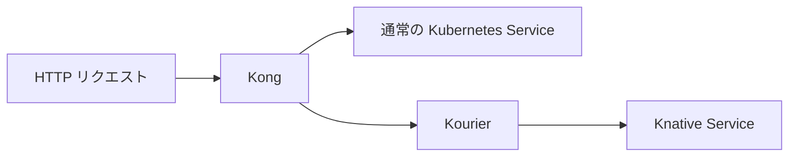

# infra-kubernetes

EC2 上に k0s・Kong・Knative を構築し、通常 Service と Knative の2経路を確認する。



## インストール

`dnf` が使える新規の専用 EC2 を使用する。
Python 3.10 以上・curl・CA 証明書・sudo・systemd が必要。

```bash
sudo dnf install -y git
mkdir projects
cd projects
git clone https://github.com/sasano8/infra-kubernetes.git
cd infra-kubernetes
```

設定ファイルを配置する。

```bash
cat > configs/environment/local.json <<'EOF'
{
  "mode": "new-host",
  "domain": "knative.tmp.ys-method-dev.com",
  "standard_host": "standard.tmp.ys-method-dev.com",
  "kourier_service": "kourier.kourier-system.svc.cluster.local",
  "node_port": null
}
EOF

sudo ./bin/infra up
```

## 動作確認

```bash
sudo python3 scripts/check-routes.py
```

port-forward を自動で起動し、次を確認する。

- Kong → 通常 Service：HTTP 200・`standard-service`
- Kong → Kourier → Knative：HTTP 200・`knative-service`
- Knative の Pod が0件になるまで待ち、再アクセスによる復帰を確認

ゼロになるまでの目安は最後のアクセスから1〜2分、最大10分待機する。
待機中は別のアクセスを止める。すべて成功すると `3/3 成功` と表示する。

## 詳細

- [構成・設定・既存クラスタへの追加](docs/setup-details.md)
- [確認手順とオプション](docs/verification.md)
- [webhook のトラブルシューティング](docs/webhook-diagnostics.md)
- [撤去](docs/cleanup.md)
- [infra-k0s との対応](docs/migration.md)
