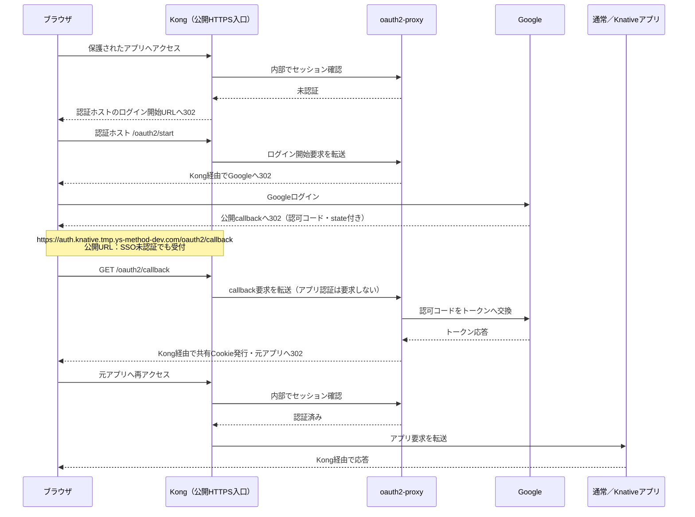
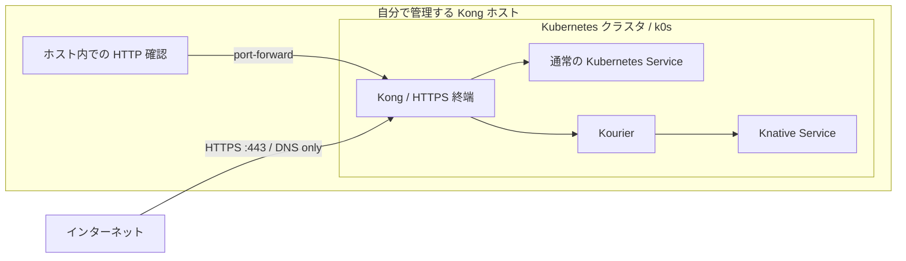

# infra-kubernetes

Linux ホスト上に k0s・Kong・Knative を構築し、通常 Service と Knative の buffer／nobuffer 計4経路を確認する。
Kong は DB-less のまま、KIC（Kong Ingress Controller）で Ingress を反映する。

## SSO認証と公開callback

構築例ではGoogle Workspace SSOを有効にし、通常／Knativeの保護されたアプリを
1回のGoogleログインで利用する。認証状態は `tmp.ys-method-dev.com` 配下のCookieで共有する。
buffer／nobufferは各アプリルートの設定を維持する。

**`https://auth.knative.tmp.ys-method-dev.com/oauth2/callback` は、SSO未認証でも到達できる公開URL。**
Googleから戻るブラウザを受け付けるため、callback自体にはアプリ用のSSO認証を要求しない。
Kongがoauth2-proxyへ転送し、oauth2-proxyが認可コード・state・CSRF Cookieを検証して
セッションを発行する。URLを直接開くだけではログインは成立しない。



Googleへ登録する「承認済みのリダイレクトURI」は上記callbackの1件。
Googleがブラウザへ移動先を返し、ブラウザがKongへ接続する。
認証確認用の `/oauth2/auth` はクラスタ内部で使用し、外部OAuthルートでは公開しない。
設定は [SSO手順](docs/sso.md)、転送先とGoogle側の登録方法は
[SSOのリダイレクトとcallbackの仕組み](docs/sso-flow.md)を参照。

## ルーティング

Argo CD・Infisical・pinnerの導入は [プラットフォームplugin](docs/platform-plugins.md)を参照。
アプリやSecretの同期定義は別管理とし、ESOは任意pluginとして`up`から除外する。



Ingress はホスト・パスと転送先を定義し、KIC が Kong に反映する設定リソース。
通信を中継するコンポーネントではないため、上図には含めていない。
現在は Ingress を使用し、Gateway API の HTTPRoute は使用していない。
Kong の Namespace は `kong-system`、アプリは `test`。

## HTTPS と証明書（Cloudflare DNS-01）

証明書の発行元は **Let's Encrypt**。Cloudflare は DNS-01 認証用の DNS を管理する。
Cloudflare API トークンは `test/cloudflare-api-token` Secret に保存し、
`test/cloudflare-letsencrypt` Issuer が参照する。
証明書と秘密鍵は `test/standard-tls` と `test/knative-wildcard-tls` の TLS Secret に保存する。nobuffer用には `test/standard-nobuffer-tls` と
`test/knative-nobuffer-tls` も作成する。


## 用語と実行場所

| 用語 | この構成での役割 |
| --- | --- |
| Kong ホスト | k0s と Kong を動かす Linux マシン。インストールと内部確認の実行場所 |
| Kubernetes / k0s | 各コンポーネントとアプリを動かす基盤 / その配布版 |
| Kong / KIC | HTTPS の入口と転送処理 / Ingress の設定を Kong に反映するコントローラ |
| 通常 Service / Deployment | アプリへの接続先 / アプリの Pod を維持する仕組み |
| Knative / Kourier | リクエストに応じて Pod を起動し、スケールゼロも行う基盤 / Knative への入口 |
| cert-manager / TLS Secret | 証明書の取得・自動更新 / 証明書と秘密鍵の保存先 |
| Cloudflare / Let's Encrypt | DNS-01 認証用の DNS を管理 / 証明書を発行する外部サービス |
| 外部端末 | 手元の PC など、公開 DNS・HTTPS を使って Kong に接続する別のマシン |

## ホストのプロビジョニング

cloud-init 対応の Linux イメージを使い、プロビジョニング時に以下を渡す。
公開鍵は自分のものに置き換える。

```yaml
#cloud-config
ssh_authorized_keys:
  - ssh-ed25519 AAAA...あなたの公開鍵... user@pc
```

イメージの既定ユーザーに SSH 公開鍵を登録する。
プロビジョニング完了後、そのユーザーで SSH 接続して以下の手順を実行する。
公開鍵の確認、cloud-init での登録、起動済みホストへのシェルでの追加は
[SSH 公開鍵の登録手順](docs/provisioning/aws-setup.md)を参照。

## インストール

Kong ホストで実行する。以下は `dnf` が使える新規の専用 Linux ホスト向けの手順。
Python 3.10 以上・curl・CA 証明書・sudo・systemd が必要。

```bash
sudo dnf install -y git make
mkdir projects
cd projects
git clone https://github.com/sasano8/infra-kubernetes.git
cd infra-kubernetes
```

Argo CD・Infisicalの導入には、**Helm 3.13以降の3系**も必要。
`make install-helm`で未導入ならv3.19.0をSHA-256検証後に`/usr/local/bin/helm`へ導入し、
導入済みなら配備時と同じsudo環境でバージョンを確認する。

```bash
make install-helm
```

HTTPS・Google Workspace SSO・Argo CD・Infisical・pinnerを有効にした設定ファイルを配置する。
`tls.email` は連絡先、`sso.email_domain` はログインを許可するWorkspaceのメールドメインに変更する。

```bash
cat > configs/environment/local.json <<'EOF'
{
  "mode": "new-host",
  "base_domain": "tmp.ys-method-dev.com",
  "knative_domain": "knative.tmp.ys-method-dev.com",
  "standard_domain": "standard.tmp.ys-method-dev.com",
  "standard_nobuffer_domain": "standard-nobuffer.tmp.ys-method-dev.com",
  "knative_nobuffer_domain": "knative-nobuffer.tmp.ys-method-dev.com",
  "kourier_service": "kourier.kourier-system.svc.cluster.local",
  "node_port": null,
  "tls": {
    "enabled": true,
    "email": "you@example.com",
    "cloudflare_zone": "ys-method-dev.com",
    "host_https_port": 443
  },
  "sso": {
    "enabled": true,
    "email_domain": "ys-method.com",
    "auth_host": "auth.knative.tmp.ys-method-dev.com",
    "cookie_domain": "tmp.ys-method-dev.com",
    "cookie_expire_hours": 72,
    "secret_file": ".local/secrets/google-sso.json",
    "routes": {
      "standard_domain": "browser",
      "standard_nobuffer_domain": "browser",
      "knative_domain": "browser",
      "knative_nobuffer_domain": "browser"
    }
  },
  "plugins": {
    "argocd": {"enabled": true},
    "infisical": {"enabled": true},
    "pinner": {"enabled": true}
  }
}
EOF
```

`base_domain` は共通の参照情報。`knative_domain` は Knative 用、
`standard_domain` は通常経路のベースドメインとして個別指定する。

この例の`make up`は、基本構成に続いて **Argo CD → Infisical → pinner** を導入する。
`plugins`省略時、または各`enabled=false`の場合、その追加pluginは導入・更新しない。
**ESOは`up`に含めず**、必要な場合だけ`plugin install external-secrets`で導入する。
Argo CDのApplication・Git接続、Infisicalの接続・Secret同期定義は別管理。
pinnerは全Namespaceを監視し、annotationで明示したリソースを処理する。既定では実際に更新を実行する。
個別導入・待機・管理UIへの接続方法は [プラットフォームplugin](docs/platform-plugins.md)を参照。

続いて Cloudflare API トークンを配置する。
[トークンの取得手順](docs/https.md#2-cloudflare-api-トークンを配置)で作成し、
リポジトリのルートで以下を実行して貼り付ける（入力は画面に表示されない）。

```bash
sudo install -d -o "$(id -un)" -g "$(id -gn)" -m 700 .local .local/secrets
sudo touch .local/secrets/cloudflare-api-token
sudo chown "$(id -un):$(id -gn)" .local/secrets/cloudflare-api-token
sudo chmod 600 .local/secrets/cloudflare-api-token
(
  umask 077
  read -r -s -p 'Cloudflare API token: ' cf_api_token
  printf '\n'
  printf '%s' "$cf_api_token" > .local/secrets/cloudflare-api-token
  unset cf_api_token
)
```

Google OAuthクライアントへ `https://auth.knative.tmp.ys-method-dev.com/oauth2/callback` を登録し、
[SSOのSecret供給手順](docs/sso.md#secret供給)で `.local/secrets/google-sso.json` を権限600で作成する。
GoogleクライアントID・クライアントシークレット・Cookie鍵が必要。
`make configure-secret-google-sso` で非表示入力して作成・変更できる。変更時のCookie鍵は維持する。
既存Secretを外部管理している場合は `secret_file` を省略し、`test/google-sso` を事前に供給する。
準備がない場合、`up` はSSOを無効にせず事前検証で停止する。

[DNS・公開ポートの準備](docs/https.md#1-dns-と公開ポートの準備)を済ませてから、検証・インストールする。
DNS は **DNS only** で Kong ホストに到達する公開 IP に向け、ファイアウォールで443/TCPを許可する。
ホスト側と外部側のファイアウォールで受信を許可する。

```bash
sudo ./bin/infra validate --require-https
sudo ./bin/infra up --require-https
```

設定だけを確認する場合は `sudo ./bin/infra validate --require-https`。
`up` も開始時に設定と必要なトークンを検証し、不足していれば構築前に停止する。

一括構築は `up`、工程ごとの再実行は `plugin install`・`apply-*`・`wait-*` を使う。
例えば証明書の設定適用と発行待機は分けて実行できる。

```bash
sudo ./bin/infra apply-certificates --kubectl 'k0s kubectl'
sudo ./bin/infra wait-certificates --kubectl 'k0s kubectl'
```

標準導入・設定注入・個別設定の分担と全コマンドは [工程別の構築手順](docs/setup-phases.md)を参照。

Namespace は `test`。公開ホスト名はアプリ名・Namespace・種類の順に揃える。

| 種類 | リソース名 | 公開ホスト名 |
| --- | --- | --- |
| Knative buffer（ksvc） | `hello` | `hello-test-ksvc.<knative_domain>` |
| 通常 buffer（ssvc） | `hello-ssvc` | `hello-test-ssvc.<standard_domain>` |
| 通常 nobuffer（同じ Service） | `hello-ssvc` | `hello-test-ssvc.<standard_nobuffer_domain>` |
| Knative nobuffer | `hello-nobuffer` | `hello-nobuffer-test-ksvc.<knative_nobuffer_domain>` |

## 動作確認

### Kong ホスト上：内部経路・スケールゼロ復帰

SSO有効時は内部診断を種別ごとに実行する。外部DNS・HTTPS・Kongの認証確認は含まない。

```bash
sudo python3 scripts/check-routes.py --internal standard
sudo python3 scripts/check-routes.py --internal knative
```

通常はServiceへ、KnativeはKourierへ127.0.0.1のport-forwardで接続する。
通常3ホストのHTTP 200・Host保持と、Knative3ホストのHTTP 200・Host保持・Podゼロからの復帰を確認する。
内部確認はそれぞれ `3/3 成功`、`6/6 成功` が目安。外部SSO成功の証拠にはしない。
ゼロになるまでの目安は最後のアクセスから1〜2分、最大10分待機する。
待機中は別のアクセスを止める。

### 外部端末から：DNS・HTTPS・SSO

Kongホストで、設定に対応する外部確認対象と期待応答を生成する。

```bash
./bin/infra test-plan --format markdown
./bin/infra test-plan --format shell > .local/external-sso-check.sh
```

生成されたURLを外部PCから確認する。上記のSSO有効例では6ホストとも未認証はHTTP 302、
Locationは `https://auth.knative.tmp.ys-method-dev.com/oauth2/start?rd=...` が期待値。HTTP 200を未認証時の成功条件にしない。
シェルはBashのある外部端末へ渡して実行できる。TLS検証を有効にし、リダイレクトを追わない。
ブラウザでGoogleログイン後に `/get` へ戻り、go-httpbinのJSONを確認する。
初回のcallback登録・ログイン確認は [SSO手順](docs/sso.md)を参照。

HTTPS 公開の設定・証明書の発行と更新・診断は [HTTPS の詳細手順](docs/https.md)を参照。

## 詳細

古いリソースは Git 履歴との差分から確認・削除できる（`apply` は削除を実行する）。

```bash
sudo python3 scripts/prune-resources.py plan
sudo python3 scripts/prune-resources.py apply
```

[削除候補・保留条件・配備記録の詳細](docs/pruning.md)

- [構成・設定・既存クラスタへの追加](docs/setup-details.md)
- [HTTPS・証明書の自動発行と更新](docs/https.md)
- [KIC 構成と既存環境の移行](docs/kic.md)
- [確認手順とオプション](docs/verification.md)
- [webhook のトラブルシューティング](docs/webhook-diagnostics.md)
- [撤去](docs/cleanup.md)
- [infra-k0s との対応](docs/migration.md)

### 疎通・ストリーミング用アプリ

通常 Service と Knative の hello は、同じ `ghcr.io/mccutchen/go-httpbin:2.21.0` を使用する。
リソース名・公開 URL は維持し、`/get` で疎通と Host 保持を確認する。
既存ドメインは request／response buffering 有効、追加する nobuffer ドメインは無効。
`/headers`、`/drip`、`/stream-bytes`、`/upload` の確認方法は
[ストリーミング検証](docs/streaming.md)を参照。アプリ別設定の自動反映は SAS-68 の別課題。

4ドメインの設定・DNS・Knativeラベル・既存設定からの移行は [4経路の構成](docs/four-routes.md)を参照。

KnativeアプリはService本体の `metadata.labels` に
`infra.sasano8.dev/route: knative_domain` または
`infra.sasano8.dev/route: knative_nobuffer_domain` を指定して公開ルートを選ぶ。
アプリがbufferingの真偽を指定するのではなく、通信特性は選択したルートの定義に従う。

インストール時に `default_routes.standard` と `default_routes.knative` を選択できる。
両方とも有効なルートが必須で、既定ルートの無効化は未対応。
明示指定を省略した場合は設定した既定を使う。既定利用の追加2サンプルと3つのKnativeの復帰を
含め、確認スクリプトは計9項目を確認する。設定例とURLは [4経路の構成](docs/four-routes.md)を参照。

## Google Workspace SSO

このREADMEの構築例は `sso.enabled=true`。無効にする場合は明示的にfalseを指定する。
ルートのbrowser／api／publicポリシーに従い、
Kongの認証確認後に本文をアプリへ転送する。buffer／nobuffer設定は独立して維持する。
有効時はHTTPS・許可メールドメイン・Google OAuth／Cookie用Secretが必要。
Googleのログイン後は共通callbackへ戻り、Kongがoauth2-proxyへ転送する。
認証完了後は共有Cookieを設定して元のアプリへ戻るため、Googleへのcallback登録は1件でよい。
[SSOのリダイレクトとcallbackの仕組み](docs/sso-flow.md)に、通信図・Kongのルート条件・
Google側へのリダイレクトURI追加手順をまとめている。
設定・Google callback登録・検証の制約は [SSO手順](docs/sso.md)を参照。
資格情報の変更は次のMakefileターゲットを使う。適用・再起動・待機は分離している。

```bash
make configure-secret-google-sso
make apply-secret-google-sso
make restart-deployment-oauth2-proxy
make wait-deployment-oauth2-proxy
```

許可ドメインやルートなどの設定変更は `make edit-config` → `make up`。
詳細は `make help` と [SSO設定の変更手順](docs/sso.md#makefileで作成変更する)を参照。

SSO有効時の既存疎通スクリプトは `--internal standard`／`--internal knative` の内部診断用とし、
外部確認は `bin/infra test-plan --format markdown` で生成する。実Googleログイン・実クラスタ検証は未実施。

Google IDトークンをアプリ自身で検証する場合は、`sso.id_token_routes` に対象の公開ルートを指定する。
`sso.id_token_header`（既定 `X-Forwarded-Id-Token`）で渡し、アプリ側の `SSO_ID_TOKEN_HEADER` と揃える。
既定は転送無効。設定例と受信アプリ側の条件は [SSO手順](docs/sso.md#idトークンの転送)を参照。
