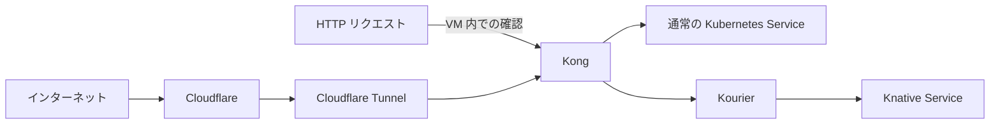

# infra-kubernetes

EC2 上に k0s・Kong・Knative を構築し、通常 Service と Knative の2経路を確認する。



## インストール

`dnf` が使える新規の専用 EC2 を使用する。
Python 3.10 以上・curl・CA 証明書・sudo・systemd が必要。

```bash
sudo dnf install -y git
mkdir projects
cd projects
git clone https://github.com/sasano8/infra-kubernetes.git
cd infra-kubernetes
```

設定ファイルを配置する。

```bash
cat > configs/environment/local.json <<'EOF'
{
  "mode": "new-host",
  "base_domain": "tmp.ys-method-dev.com",
  "knative_domain": "knative.tmp.ys-method-dev.com",
  "standard_domain": "standard.tmp.ys-method-dev.com",
  "kourier_service": "kourier.kourier-system.svc.cluster.local",
  "node_port": null
}
EOF

sudo ./bin/infra up
```

`base_domain` は共通の参照情報。`knative_domain` は Knative 用、
`standard_domain` は通常経路用に個別指定する。

## 動作確認

```bash
sudo python3 scripts/check-routes.py
```

port-forward を自動で起動し、次を確認する。

- Kong → 通常 Service：HTTP 200・`standard-service`
- Kong → Kourier → Knative：HTTP 200・`knative-service`
- Knative の Pod が0件になるまで待ち、再アクセスによる復帰を確認

ゼロになるまでの目安は最後のアクセスから1〜2分、最大10分待機する。
待機中は別のアクセスを止める。すべて成功すると `3/3 成功` と表示する。

## Cloudflare で公開

Cloudflare Tunnel を使う。EC2 の受信ポートや既存 Caddy の設定は変更しない。

1. `configs/environment/local.json` の `node_port` を `30081` に変更して再配備する。

   ```bash
   sudo ./bin/infra deploy --kubectl 'k0s kubectl'
   ```

2. [cloudflared の導入手順](docs/cloudflare.md#cloudflared-の導入)に沿って EC2 に導入し、
   Cloudflare の **Networking → Tunnels**（または Zero Trust の Tunnels）でトンネルを作る。
   画面の Linux 向けサービス登録コマンドを EC2 で実行する。
3. 次の公開ホスト名を登録し、両方の転送先を `http://<EC2 のプライベート IP>:30081` にする。
   **HTTP Host Header は上書きしない**。

   | 公開ホスト名 | 経路 |
   | --- | --- |
   | `standard.tmp.ys-method-dev.com` | 通常 Service |
   | `sas47-apps--serverless.knative.tmp.ys-method-dev.com` | Kourier → Knative |

4. 外部から確認する。

   ```bash
   curl --fail-with-body https://standard.tmp.ys-method-dev.com/
   curl --fail-with-body https://sas47-apps--serverless.knative.tmp.ys-method-dev.com/
   ```

これらの多段サブドメインをカバーする Cloudflare のエッジ証明書が必要。
通常の Universal SSL だけでは足りない場合がある。
前提・トークンの扱い・証明書・撤去は [Cloudflare 公開手順](docs/cloudflare.md)を参照。

## 詳細

- [構成・設定・既存クラスタへの追加](docs/setup-details.md)
- [確認手順とオプション](docs/verification.md)
- [webhook のトラブルシューティング](docs/webhook-diagnostics.md)
- [撤去](docs/cleanup.md)
- [infra-k0s との対応](docs/migration.md)
