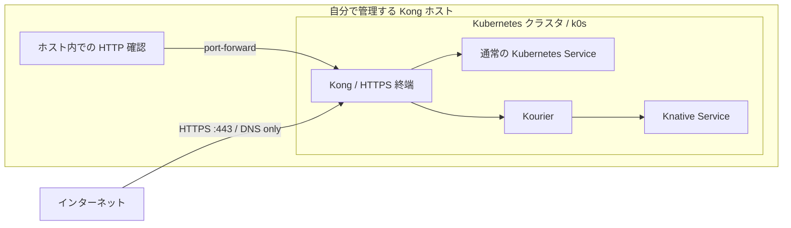

# infra-kubernetes

Linux ホスト上に k0s・Kong・Knative を構築し、通常 Service と Knative の buffer／nobuffer 計4経路を確認する。
Kong は DB-less のまま、KIC（Kong Ingress Controller）で Ingress を反映する。

## ルーティング



Ingress はホスト・パスと転送先を定義し、KIC が Kong に反映する設定リソース。
通信を中継するコンポーネントではないため、上図には含めていない。
現在は Ingress を使用し、Gateway API の HTTPRoute は使用していない。
Kong の Namespace は `kong-system`、アプリは `test`。

## HTTPS と証明書（Cloudflare DNS-01）

証明書の発行元は **Let's Encrypt**。Cloudflare は DNS-01 認証用の DNS を管理する。
Cloudflare API トークンは `test/cloudflare-api-token` Secret に保存し、
`test/cloudflare-letsencrypt` Issuer が参照する。
証明書と秘密鍵は `test/standard-tls` と `test/knative-wildcard-tls` の TLS Secret に保存する。nobuffer用には `test/standard-nobuffer-tls` と
`test/knative-nobuffer-tls` も作成する。


## 用語と実行場所

| 用語 | この構成での役割 |
| --- | --- |
| Kong ホスト | k0s と Kong を動かす Linux マシン。インストールと内部確認の実行場所 |
| Kubernetes / k0s | 各コンポーネントとアプリを動かす基盤 / その配布版 |
| Kong / KIC | HTTPS の入口と転送処理 / Ingress の設定を Kong に反映するコントローラ |
| 通常 Service / Deployment | アプリへの接続先 / アプリの Pod を維持する仕組み |
| Knative / Kourier | リクエストに応じて Pod を起動し、スケールゼロも行う基盤 / Knative への入口 |
| cert-manager / TLS Secret | 証明書の取得・自動更新 / 証明書と秘密鍵の保存先 |
| Cloudflare / Let's Encrypt | DNS-01 認証用の DNS を管理 / 証明書を発行する外部サービス |
| 外部端末 | 手元の PC など、公開 DNS・HTTPS を使って Kong に接続する別のマシン |

## インストール

Kong ホストで実行する。以下は `dnf` が使える新規の専用 Linux ホスト向けの手順。
Python 3.10 以上・curl・CA 証明書・sudo・systemd が必要。

```bash
sudo dnf install -y git
mkdir projects
cd projects
git clone https://github.com/sasano8/infra-kubernetes.git
cd infra-kubernetes
```

HTTPS 公開用の設定ファイルを配置する。`email` は受信できる自分のメールアドレスに変更する。

```bash
cat > configs/environment/local.json <<'EOF'
{
  "mode": "new-host",
  "base_domain": "tmp.ys-method-dev.com",
  "knative_domain": "knative.tmp.ys-method-dev.com",
  "standard_domain": "standard.tmp.ys-method-dev.com",
  "standard_nobuffer_domain": "standard-nobuffer.tmp.ys-method-dev.com",
  "knative_nobuffer_domain": "knative-nobuffer.tmp.ys-method-dev.com",
  "kourier_service": "kourier.kourier-system.svc.cluster.local",
  "node_port": null,
  "tls": {
    "enabled": true,
    "email": "you@example.com",
    "cloudflare_zone": "ys-method-dev.com",
    "host_https_port": 443
  }
}
EOF
```

`base_domain` は共通の参照情報。`knative_domain` は Knative 用、
`standard_domain` は通常経路のベースドメインとして個別指定する。

続いて Cloudflare API トークンを配置する。
[トークンの取得手順](docs/https.md#2-cloudflare-api-トークンを配置)で作成し、
リポジトリのルートで以下を実行して貼り付ける（入力は画面に表示されない）。

```bash
sudo install -d -o "$(id -un)" -g "$(id -gn)" -m 700 .local .local/secrets
sudo touch .local/secrets/cloudflare-api-token
sudo chown "$(id -un):$(id -gn)" .local/secrets/cloudflare-api-token
sudo chmod 600 .local/secrets/cloudflare-api-token
(
  umask 077
  read -r -s -p 'Cloudflare API token: ' cf_api_token
  printf '\n'
  printf '%s' "$cf_api_token" > .local/secrets/cloudflare-api-token
  unset cf_api_token
)
```

[DNS・公開ポートの準備](docs/https.md#1-dns-と-ec2-の準備)を済ませてから、検証・インストールする。
DNS は **DNS only** で Kong ホストに到達する公開 IP に向け、ファイアウォールで443/TCPを許可する。
クラウド環境ではセキュリティグループなどの受信ルールも設定する。

```bash
sudo ./bin/infra validate --require-https
sudo ./bin/infra up --require-https
```

設定だけを確認する場合は `sudo ./bin/infra validate --require-https`。
`up` も開始時に設定と必要なトークンを検証し、不足していれば構築前に停止する。

Namespace は `test`。公開ホスト名はアプリ名・Namespace・種類の順に揃える。

| 種類 | リソース名 | 公開ホスト名 |
| --- | --- | --- |
| Knative buffer（ksvc） | `hello` | `hello-test-ksvc.<knative_domain>` |
| 通常 buffer（ssvc） | `hello-ssvc` | `hello-test-ssvc.<standard_domain>` |
| 通常 nobuffer（同じ Service） | `hello-ssvc` | `hello-test-ssvc.<standard_nobuffer_domain>` |
| Knative nobuffer | `hello-nobuffer` | `hello-nobuffer-test-ksvc.<knative_nobuffer_domain>` |

## 動作確認

### Kong ホスト上：経路・スケールゼロ復帰

Kong ホスト上で実行する。外部 DNS・公開443番・証明書の確認は含まない。

```bash
sudo python3 scripts/check-routes.py
```

port-forward を自動で起動し、次を確認する。

- Kong → 通常 Service：HTTP 200・go-httpbin JSON の通常 Service 側 Host
- Kong → Kourier → Knative：HTTP 200・go-httpbin JSON の Knative 側 Host
- 通常／Knative の nobuffer 経路：HTTP 200 と公開 Host の保持
- Knative 2サービスの Pod がそれぞれ0件になるまで待ち、再アクセスによる復帰を確認

ゼロになるまでの目安は最後のアクセスから1〜2分、最大10分待機する。
待機中は別のアクセスを止める。すべて成功すると `6/6 成功` と表示する。

### 外部端末から：DNS・HTTPS・4経路

手元の PC など、Kong ホスト以外の外部端末から実行する。証明書も検証するため `-k` は付けない。

```bash
curl --fail-with-body --max-time 180 https://hello-test-ssvc.standard.tmp.ys-method-dev.com/get
curl --fail-with-body --max-time 180 https://hello-test-ksvc.knative.tmp.ys-method-dev.com/get
curl --fail-with-body --max-time 180 https://hello-test-ssvc.standard-nobuffer.tmp.ys-method-dev.com/get
curl --fail-with-body --max-time 180 https://hello-nobuffer-test-ksvc.knative-nobuffer.tmp.ys-method-dev.com/get
```

それぞれ go-httpbin の JSON（`headers.Host` が各公開ホスト） が返れば成功。
内部確認のゼロスケール待機が終わってから実行する。

HTTPS 公開の設定・証明書の発行と更新・診断は [HTTPS の詳細手順](docs/https.md)を参照。

## 詳細

古いリソースは Git 履歴との差分から確認・削除できる（`apply` は削除を実行する）。

```bash
sudo python3 scripts/prune-resources.py plan
sudo python3 scripts/prune-resources.py apply
```

[削除候補・保留条件・配備記録の詳細](docs/pruning.md)

- [構成・設定・既存クラスタへの追加](docs/setup-details.md)
- [HTTPS・証明書の自動発行と更新](docs/https.md)
- [KIC 構成と既存環境の移行](docs/kic.md)
- [確認手順とオプション](docs/verification.md)
- [webhook のトラブルシューティング](docs/webhook-diagnostics.md)
- [撤去](docs/cleanup.md)
- [infra-k0s との対応](docs/migration.md)

### 疎通・ストリーミング用アプリ

通常 Service と Knative の hello は、同じ `ghcr.io/mccutchen/go-httpbin:2.21.0` を使用する。
リソース名・公開 URL は維持し、`/get` で疎通と Host 保持を確認する。
既存ドメインは request／response buffering 有効、追加する nobuffer ドメインは無効。
`/headers`、`/drip`、`/stream-bytes`、`/upload` の確認方法は
[ストリーミング検証](docs/streaming.md)を参照。アプリ別設定の自動反映は SAS-68 の別課題。

4ドメインの設定・DNS・Knativeラベル・既存設定からの移行は [4経路の構成](docs/four-routes.md)を参照。
