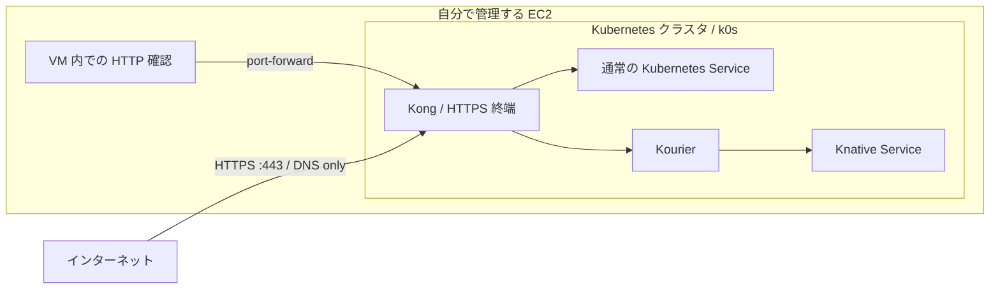
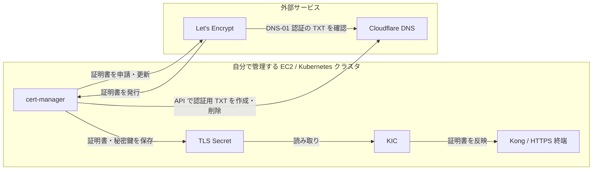

# infra-kubernetes

EC2 上に k0s・Kong・Knative を構築し、通常 Service と Knative の2経路を確認する。
Kong は DB-less のまま、KIC（Kong Ingress Controller）で Ingress を反映する。



Ingress はホスト・パスと転送先を定義し、KIC が Kong に反映する設定リソース。
通信を中継するコンポーネントではないため、上図には含めていない。
現在は Ingress を使用し、Gateway API の HTTPRoute は使用していない。
Kong の Namespace は `kong-system`、アプリは `test`。
証明書用 Secret は `cloudflare-api-token`、Issuer は `cloudflare-letsencrypt` を使う。

### HTTPS と証明書（Cloudflare DNS-01）

証明書の発行元は **Let's Encrypt**。Cloudflare は DNS-01 認証用の DNS を管理する。



## インストール

`dnf` が使える新規の専用 EC2 を使用する。
Python 3.10 以上・curl・CA 証明書・sudo・systemd が必要。

```bash
sudo dnf install -y git
mkdir projects
cd projects
git clone https://github.com/sasano8/infra-kubernetes.git
cd infra-kubernetes
```

HTTPS 公開用の設定ファイルを配置する。`email` は受信できる自分のメールアドレスに変更する。

```bash
cat > configs/environment/local.json <<'EOF'
{
  "mode": "new-host",
  "base_domain": "tmp.ys-method-dev.com",
  "knative_domain": "knative.tmp.ys-method-dev.com",
  "standard_domain": "standard.tmp.ys-method-dev.com",
  "kourier_service": "kourier.kourier-system.svc.cluster.local",
  "node_port": null,
  "tls": {
    "enabled": true,
    "email": "you@example.com",
    "cloudflare_zone": "ys-method-dev.com",
    "host_https_port": 443
  }
}
EOF
```

`base_domain` は共通の参照情報。`knative_domain` は Knative 用、
`standard_domain` は通常経路のベースドメインとして個別指定する。

続いて Cloudflare API トークンを配置する。
[トークンの取得手順](docs/https.md#2-cloudflare-api-トークンを配置)で作成し、
リポジトリのルートで以下を実行して貼り付ける（入力は画面に表示されない）。

```bash
sudo install -d -o "$(id -un)" -g "$(id -gn)" -m 700 .local .local/secrets
sudo touch .local/secrets/cloudflare-api-token
sudo chown "$(id -un):$(id -gn)" .local/secrets/cloudflare-api-token
sudo chmod 600 .local/secrets/cloudflare-api-token
(
  umask 077
  read -r -s -p 'Cloudflare API token: ' cf_api_token
  printf '\n'
  printf '%s' "$cf_api_token" > .local/secrets/cloudflare-api-token
  unset cf_api_token
)
```

[DNS・EC2 の準備](docs/https.md#1-dns-と-ec2-の準備)を済ませてから、検証・インストールする。
DNS は **DNS only** で EC2 のパブリック IP に向け、セキュリティグループで443/TCPを許可する。

```bash
sudo ./bin/infra validate --require-https
sudo ./bin/infra up --require-https
```

設定だけを確認する場合は `sudo ./bin/infra validate --require-https`。
`up` も開始時に設定と必要なトークンを検証し、不足していれば構築前に停止する。

Namespace は `test`。公開ホスト名はアプリ名・Namespace・種類の順に揃える。

| 種類 | リソース名 | 公開ホスト名 |
| --- | --- | --- |
| Knative Service（ksvc） | `hello` | `hello-test-ksvc.<knative_domain>` |
| 通常 Service / Deployment（ssvc） | `hello-ssvc` | `hello-test-ssvc.<standard_domain>` |

## 動作確認

### 内部から：経路・スケールゼロ復帰

EC2 上で実行する。外部 DNS・公開443番・証明書の確認は含まない。

```bash
sudo python3 scripts/check-routes.py
```

port-forward を自動で起動し、次を確認する。

- Kong → 通常 Service：HTTP 200・`standard-service`
- Kong → Kourier → Knative：HTTP 200・`knative-service`
- Knative の Pod が0件になるまで待ち、再アクセスによる復帰を確認

ゼロになるまでの目安は最後のアクセスから1〜2分、最大10分待機する。
待機中は別のアクセスを止める。すべて成功すると `3/3 成功` と表示する。

### 外部から：DNS・HTTPS・両経路

手元の PC など、EC2 の外部から実行する。証明書も検証するため `-k` は付けない。

```bash
curl --fail-with-body --max-time 180 https://hello-test-ssvc.standard.tmp.ys-method-dev.com/
curl --fail-with-body --max-time 180 https://hello-test-ksvc.knative.tmp.ys-method-dev.com/
```

それぞれ `standard-service` / `knative-service` が返れば成功。
内部確認のゼロスケール待機が終わってから実行する。

HTTPS 公開の設定・証明書の発行と更新・診断は [HTTPS の詳細手順](docs/https.md)を参照。

## 詳細

古いリソースは Git 履歴との差分から確認・削除できる（`apply` は削除を実行する）。

```bash
sudo python3 scripts/prune-resources.py plan
sudo python3 scripts/prune-resources.py apply
```

[削除候補・保留条件・配備記録の詳細](docs/pruning.md)

- [構成・設定・既存クラスタへの追加](docs/setup-details.md)
- [HTTPS・証明書の自動発行と更新](docs/https.md)
- [KIC 構成と既存環境の移行](docs/kic.md)
- [確認手順とオプション](docs/verification.md)
- [webhook のトラブルシューティング](docs/webhook-diagnostics.md)
- [撤去](docs/cleanup.md)
- [infra-k0s との対応](docs/migration.md)
