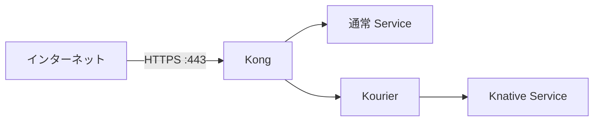

# Cloudflare API を使った証明書の自動発行・更新

cert-manager が Cloudflare API で DNS-01 検証用の TXT レコードを作り、
Let's Encrypt が証明書を発行する。KIC が証明書 Secret を Kong に反映する。
Cloudflare は DNS の管理・検証に使い、HTTPS は Kong ホストで終端する。



## 1. Cloudflare API トークンを取得

[My Profile → API Tokens](https://dash.cloudflare.com/profile/api-tokens) を開き、
**Create Token → Edit zone DNS** テンプレートを選ぶ。

| 設定 | 値 |
| --- | --- |
| Permissions | Zone → DNS → Edit、Zone → Zone → Read |
| Zone Resources | Include → Specific zone → `ys-method-dev.com` |

**Continue to summary → Create Token** で発行してコピーする。
Global API Key ではなく API トークンを使う。トークンをチャットや Git に貼らない。

## 2. トークンを Kong ホストに配置

Kong ホストのリポジトリのルートで実行する。
既に sudo で構築済みでも書き込めるよう、生成ディレクトリの所有者をログインユーザーに揃える。

```bash
sudo install -d -o "$(id -un)" -g "$(id -gn)" -m 700 .local .local/secrets
sudo touch .local/secrets/cloudflare-api-token
sudo chown "$(id -un):$(id -gn)" .local/secrets/cloudflare-api-token
sudo chmod 600 .local/secrets/cloudflare-api-token
(
  umask 077
  read -r -s -p 'Cloudflare API token: ' cf_api_token
  printf '\n'
  printf '%s' "$cf_api_token" > .local/secrets/cloudflare-api-token
  unset cf_api_token
)
```

貼り付けても入力は表示されない。Enter で確定する。

## 3. DNS と公開ポートの設定

以下の A レコードを **DNS only** で Kong ホストの公開 IP に向ける。

- `standard.tmp.ys-method-dev.com`
- `*.standard.tmp.ys-method-dev.com`
- `knative.tmp.ys-method-dev.com`
- `*.knative.tmp.ys-method-dev.com`

ホスト側と外部側のファイアウォールで443/TCPを検証元から許可する。
DNS-01 のため、証明書発行用の80番受信許可は不要。
Cloudflare のエッジ証明書や多段サブドメインの Universal SSL 設定は使わない。

## 4. TLS を有効化して構築

`configs/environment/local.json` に次を追加する。メールアドレスは自分の連絡先に変更する。

```json
"tls": {
  "enabled": true,
  "email": "you@example.com",
  "cloudflare_zone": "ys-method-dev.com",
  "host_https_port": 443
}
```

```bash
git pull origin main
sudo ./bin/infra validate --require-https
sudo ./bin/infra up --require-https
```

設定とトークンを事前検証し、cert-manager 導入・証明書発行・Kong の443番公開まで行う。
更新は cert-manager が自動で行うため、Cloudflare トークンを有効に保つ。

## 5. 確認

```bash
curl --fail-with-body --max-time 180 https://hello-test-ssvc.standard.tmp.ys-method-dev.com/get
curl --fail-with-body --max-time 180 https://hello-test-ksvc.knative.tmp.ys-method-dev.com/get
sudo python3 scripts/check-routes.py
```

期待する本文は go-httpbin の JSON（`headers.Host` が各公開ホスト）。
確認スクリプトは VM 内の HTTP 4経路とスケールゼロ復帰を確認する。
外部 HTTPS は上記の curl で証明書を検証したまま確認する。

完全な設定例、証明書の対象、発行状況・更新・撤去は [HTTPS の詳細](https.md) を参照。

nobuffer用の2ドメインにもDNSレコードが必要。[4経路のDNS一覧](four-routes.md)を参照。
