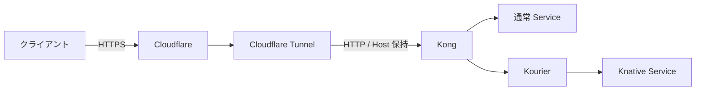

# Cloudflare Tunnel による公開

VM 内の経路確認後、Cloudflare Tunnel で Kong を公開する任意の手順。
この手順の外部公開は未実施。Cloudflare アカウント・対象 DNS ゾーンの管理権限が必要。
HTTP のアプリは外部からアクセス可能になる。認証の追加はこの最小検証の対象外。



HTTPS は Cloudflare で終端し、同じ EC2 上の cloudflared から Kong へ HTTP で転送する。
既存の Caddy や本番 DNS レコードには手を加えない。
同名の既存レコードがある場合は上書きせず、別の検証用名を設定する。

## 1. Kong の NodePort を設定

`configs/environment/local.json` の `node_port` を `30081` にする。
ホスト名は README の設定を前提にする。

```bash
sudo ./bin/infra deploy --kubectl 'k0s kubectl'
sudo k0s kubectl -n sas47-kong get service kong-proxy
sudo k0s kubectl get nodes -o wide
```

Node の InternalIP を転送先に使う。ここでは例を `172.31.4.180` とするが、
新しい EC2 では実際の値に置き換える。
cloudflared は同じホストから接続するので、セキュリティグループに30081番の
インターネット向け受信許可を追加する必要はない。
NodePort はノードのインターフェースで待ち受けるため、既存の広い受信許可がないことも確認する。
ホストのファイアウォールでは同じホストからの接続を許可する。

## cloudflared の導入

Amazon Linux の `dnf` 環境では、Cloudflare の公式 RPM リポジトリを登録する。
パッケージの署名検証は有効のまま使用する。

```bash
curl --fail --silent --show-error --location \
  https://pkg.cloudflare.com/cloudflared-ascii.repo \
  -o /tmp/cloudflared.repo
sudo install -m 0644 /tmp/cloudflared.repo /etc/yum.repos.d/cloudflared.repo
sudo dnf install -y cloudflared
cloudflared --version
```

OS に対応する導入方法は [公式パッケージ案内](https://pkg.cloudflare.com/index.html)も参照。
トンネルには Cloudflare への送信通信が必要。
通常は7844番の UDP（QUIC）または TCP（HTTP/2）を使用する。
EC2 の受信 SSH 以外に、トンネル用の受信ポートを開く必要はない。

## 3. トンネルを作成して接続

Cloudflare ダッシュボードの **Networking → Tunnels**、または Zero Trust の
**Networks → Connectors / Tunnels** から Cloudflared トンネルを作成する。
画面名は UI の更新で異なる場合がある。

Linux の実行環境を選択し、画面に表示されるサービス登録コマンドを EC2 で実行する。
形式は `sudo cloudflared service install <トンネルトークン>`。
実際のトークンは Cloudflare から取得し、チャットや Git に保存しない。
サービスの状態を確認する。

```bash
sudo systemctl enable --now cloudflared
sudo systemctl status cloudflared --no-pager
```

Cloudflare 側でコネクタが Healthy になったことを確認する。
cloudflared はホスト上で起動し、k0s 内の Pod としては追加しない。

## 4. 公開ホスト名を2つ登録

トンネルの Published application routes / Public Hostnames に次を登録する。

| 公開ホスト名 | サービス種別 | URL（実際の EC2 InternalIP に置換） |
| --- | --- | --- |
| `standard.tmp.ys-method-dev.com` | HTTP | `172.31.4.180:30081` |
| `sas47-apps--serverless.knative.tmp.ys-method-dev.com` | HTTP | `172.31.4.180:30081` |

Cloudflare の Service 設定で Type と URL が別欄なら、URL に `http://` を重複入力しない。
Origin の **HTTP Host Header は空欄**にして、クライアントの Host を保持する。
片方の Host に固定するともう片方の経路が動かなくなる。
`base_domain` は管理用情報なので、そこに自動で公開ルートを作るわけではない。

新しい公開ホスト名の DNS が対象トンネルへ向いていることを確認する。
EC2 のパブリック IP を指す A レコードは不要。

## 5. Cloudflare の証明書を確認

DNS ゾーンが `ys-method-dev.com` なら、標準の Universal SSL は通常そのゾーンの
ルートと1階層のサブドメインを対象とする。
今回の2つの多段サブドメインは、それだけではカバーされない。
「トンネルが Healthy」「DNS が登録済み」だけでは HTTPS の準備完了ではない。

Cloudflare の SSL/TLS → Edge Certificates で、両ホスト名に対応する証明書が
Active であることを確認する。契約・ゾーン構成に応じて Advanced Certificate Manager の
Total TLS や個別の証明書を利用する。
ワイルドカードも通常1階層にだけ一致し、`*.tmp.ys-method-dev.com` は
`sas47-apps--serverless.knative.tmp.ys-method-dev.com` をカバーしない。

証明書の追加を避けるなら、Cloudflare 管理ゾーン直下でカバー可能な別の名前を選び、
`standard_domain` と `knative_domain`、公開ホスト名を一緒に見直す。
TLS 検証を無効にして問題を回避しない。

## 6. 公開経路を確認

```bash
curl --fail-with-body --max-time 180 https://standard.tmp.ys-method-dev.com/
curl --fail-with-body --max-time 180 https://sas47-apps--serverless.knative.tmp.ys-method-dev.com/
```

期待する本文はそれぞれ `standard-service` / `knative-service`。
既存の `scripts/check-routes.py` は VM 内の port-forward 経路を検証するもので、
この外部 DNS・Cloudflare・HTTPS の確認を置き換えるものではない。

502 の場合は VM 上で Host を付けて `http://<InternalIP>:30081/` を確認する。
Kong の404なら Host と Kong ルートの一致、TLS エラーならエッジ証明書を確認する。
Access を別途有効化した場合、curl に認証が必要になる。

## 撤去

今回追加したトンネルの公開ルートと対応する DNS レコードを削除する。
専用トンネルなら、そのコネクタとホスト上のサービスも削除する。
既存の共有トンネルや Caddy の本番経路は削除しない。

```bash
# 今回作成した専用 cloudflared サービスだけが対象
sudo cloudflared service uninstall
```

`node_port` を `null` に戻して再配備する。

```bash
sudo ./bin/infra deploy --kubectl 'k0s kubectl'
```

ClusterIP への変更時に既存 nodePort の保持が原因で拒否された場合は、
検証専用 Service `sas47-kong/kong-proxy` だけを削除してから同じ deploy を実行する。
この操作の間、検証入口は一時停止する。
