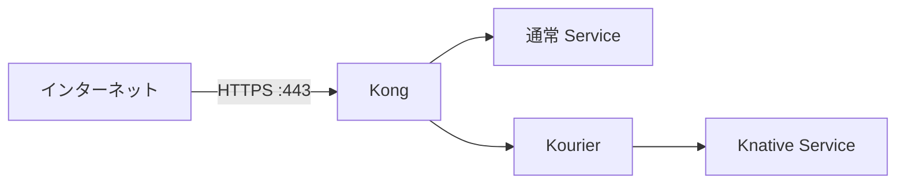

# Cloudflare API を使った証明書の自動発行・更新

cert-manager が Cloudflare API で DNS-01 検証用の TXT レコードを作り、
Let's Encrypt が証明書を発行する。KIC が証明書 Secret を Kong に反映する。
Cloudflare は DNS の管理・検証に使い、HTTPS は Kong ホストで終端する。



## 1. Cloudflare API トークンを取得

[My Profile → API Tokens](https://dash.cloudflare.com/profile/api-tokens) を開き、
**Create Token → Edit zone DNS** テンプレートを選ぶ。

| 設定 | 値 |
| --- | --- |
| Permissions | Zone → DNS → Edit、Zone → Zone → Read |
| Zone Resources | Include → Specific zone → `ys-method-dev.com` |

**Continue to summary → Create Token** で発行してコピーする。
Global API Key ではなく API トークンを使う。トークンをチャットや Git に貼らない。

## 2. トークンを Kong ホストに配置

Kong ホストのリポジトリのルートで実行する。
以前のsudo実行で`.local`がroot所有の場合は、先に作業ユーザーへ所有権を戻す。

```bash
make configure-secret-cloudflare-token
```

入力前に、設定の`tls.cloudflare_token_file`から解決した保存先を表示する。
既定の保存先は`.local/secrets/cloudflare-api-token`。トークンは非表示で入力し、
権限600で保存する。空入力・入力取消では既存トークンを上書きしない。sudoは不要。
この操作はローカルファイルへの保存だけで、Kubernetes Secretの反映は別操作。

貼り付けても入力は表示されない。Enter で確定する。

### 起動済みクラスタのトークンを更新する

同じ手順でトークンファイルを置き換えた後、Secretだけを更新する。

```bash
./bin/infra apply-secret-cloudflare-token
```

`--config` で指定した環境設定の `tls.cloudflare_token_file` を読み込む。
既定は `.local/secrets/cloudflare-api-token`。ファイルの権限と内容、既存Secretの所有ラベルを
確認して `test/cloudflare-api-token` へ反映し、トークン値は表示しない。
ファイルがない場合は更新を中止する。他のコンポーネントの配備や再起動、SSO資格情報の確認は行わない。
通常のkubectlを使う場合は `--kubectl kubectl` を指定する。

cert-managerの自動再試行による証明書発行は、別途確認する。

```bash
kubectl -n test get certificates -w
```

Cloudflare側のトークンには対象ゾーンのZone Read／DNS Edit権限が必要。
接続元IPを制限している場合は、現在のKongホストの公開IPも許可する。

## 3. DNS と公開ポートの設定

以下の A レコードを **DNS only** で Kong ホストの公開 IP に向ける。

- `standard.tmp.ys-method-dev.com`
- `*.standard.tmp.ys-method-dev.com`
- `knative.tmp.ys-method-dev.com`
- `*.knative.tmp.ys-method-dev.com`

ホスト側と外部側のファイアウォールで443/TCPを検証元から許可する。
DNS-01 のため、証明書発行用の80番受信許可は不要。
Cloudflare のエッジ証明書や多段サブドメインの Universal SSL 設定は使わない。

## 4. TLS を有効化して構築

`configs/environment/local.json` に次を追加する。メールアドレスは自分の連絡先に変更する。

```json
"tls": {
  "enabled": true,
  "email": "you@example.com",
  "cloudflare_zone": "ys-method-dev.com",
  "host_https_port": 443
}
```

```bash
git pull origin main
./bin/infra validate --require-https
./bin/infra up --require-https
```

設定とトークンを事前検証し、cert-manager 導入・証明書発行・Kong の443番公開まで行う。
更新は cert-manager が自動で行うため、Cloudflare トークンを有効に保つ。

TLS設定は抜粋。SSOも有効にする完全な設定例とGoogle認証情報の準備は
[READMEのインストール手順](../README.md#インストール)を参照。

## 5. 確認

```bash
./bin/infra test-plan --format markdown
```

生成したURLと期待応答を外部端末から確認する。READMEのSSO有効設定では未認証HTTP 302、
SSO無効の公開ルートではHTTP 200が期待値。TLS検証は有効のままとする。
SSO有効時の内部確認は `check-routes.py --internal standard` と `--internal knative` を使う。
ブラウザでログインした後、go-httpbinのJSONとHostを確認する。

完全な設定例、証明書の対象、発行状況・更新・撤去は [HTTPS の詳細](https.md) を参照。

nobuffer用の2ドメインにもDNSレコードが必要。[4経路のDNS一覧](four-routes.md)を参照。
