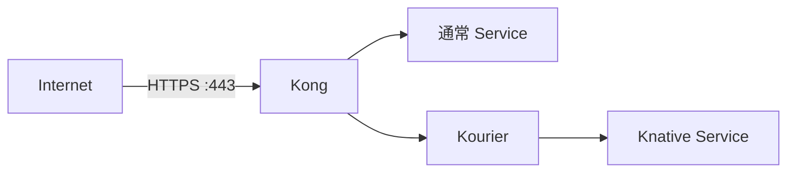

# Caddy と同じ DNS-01 自動証明書発行

cert-manager が Cloudflare DNS API を使って Let's Encrypt の証明書を発行・更新し、
KIC が Secret の変更を Kong に反映する。Caddy と Cloudflare Tunnel は使わない。
公開側の TLS は Kong で終端し、Kourier へは Host を保持して HTTP で転送する。



## 1. DNS と公開ポートの準備

Cloudflare の DNS で次の A レコードを **DNS only** として登録し、
いずれも Kong ホストの公開 IP（可能なら固定 IP）を指定する。

| 名前 | 用途 |
| --- | --- |
| `*.standard.tmp.ys-method-dev.com` | 通常 buffer のサブドメイン |
| `standard.tmp.ys-method-dev.com` | 通常 buffer のベースドメイン |
| `*.standard-nobuffer.tmp.ys-method-dev.com` | 通常nobufferのサブドメイン |
| `standard-nobuffer.tmp.ys-method-dev.com` | 通常 nobuffer のベースドメイン |
| `*.knative.tmp.ys-method-dev.com` | Knative buffer のサブドメイン |
| `knative.tmp.ys-method-dev.com` | Knative buffer のベースドメイン |
| `*.knative-nobuffer.tmp.ys-method-dev.com` | Knative nobufferのサブドメイン |
| `knative-nobuffer.tmp.ys-method-dev.com` | Knative nobuffer のベースドメイン |

同名の Tunnel 用 CNAME がある場合は、切り替える検証用のレコードだけ整理する。
SSO や Caddy の本番レコードは変更しない。
AAAA レコードを残すなら、その IPv6 接続先も Kong に到達できる必要がある。
DNS only のため、Cloudflare のエッジ証明書・Universal SSL の制約は関係しない。

ホスト側と外部側のファイアウォールで443/TCPを検証元から許可する。
証明書発行のための80番受信許可は不要。
DNS-01 の通信のため、VM と cert-manager の Pod から Cloudflare API・Let's Encrypt への
HTTPS と、DNS の53番 TCP/UDPでの問い合わせが必要。

## 2. Cloudflare API トークンを配置

[My Profile → API Tokens](https://dash.cloudflare.com/profile/api-tokens) で
**Create Token → Edit zone DNS** テンプレートを選び、次を設定する。

- Zone → DNS → Edit
- Zone → Zone → Read
- Zone Resources: Include → Specific zone → `ys-method-dev.com`

**Continue to summary → Create Token** で API トークンを発行する。
Global API Key は使わない。トークンはチャット・Git に貼らない。

Kong ホストのリポジトリのルートで、生成ディレクトリとファイルの所有者・権限を整え、非表示入力で保存する。

```bash
sudo install -d -o "$(id -un)" -g "$(id -gn)" -m 700 .local .local/secrets
sudo touch .local/secrets/cloudflare-api-token
sudo chown "$(id -un):$(id -gn)" .local/secrets/cloudflare-api-token
sudo chmod 600 .local/secrets/cloudflare-api-token
(
  umask 077
  read -r -s -p 'Cloudflare API token: ' cf_api_token
  printf '\n'
  printf '%s' "$cf_api_token" > .local/secrets/cloudflare-api-token
  unset cf_api_token
)
```

`.local/` は Git 管理外。スクリプトはこのファイルから
`test/cloudflare-api-token` Secret を作成する。
Secret 値はログや生成マニフェストへ出力せず、API エラーに値が含まれる場合も表示しない。
再実行時はファイルがあれば更新し、なければ所有ラベル付きの登録済み Secret を使用する。
更新を継続できるようトークンを有効に保つ。失効・ローテーション時はファイルを置き換えて
`sudo ./bin/infra apply-secret-cloudflare-token --kubectl 'k0s kubectl'` でSecretだけを更新できる。

## 3. 設定

`configs/environment/local.json` にHTTPS・SSO有効の設定を配置する。
`tls.email` は連絡先、`sso.email_domain` は許可するWorkspaceのメールドメインに変更する。

```json
{
  "mode": "new-host",
  "base_domain": "tmp.ys-method-dev.com",
  "knative_domain": "knative.tmp.ys-method-dev.com",
  "standard_domain": "standard.tmp.ys-method-dev.com",
  "standard_nobuffer_domain": "standard-nobuffer.tmp.ys-method-dev.com",
  "knative_nobuffer_domain": "knative-nobuffer.tmp.ys-method-dev.com",
  "kourier_service": "kourier.kourier-system.svc.cluster.local",
  "node_port": null,
  "tls": {
    "enabled": true,
    "email": "you@example.com",
    "cloudflare_zone": "ys-method-dev.com",
    "cloudflare_token_file": ".local/secrets/cloudflare-api-token",
    "acme_server": "https://acme-v02.api.letsencrypt.org/directory",
    "host_https_port": 443
  },
  "sso": {
    "enabled": true,
    "email_domain": "ys-method.com",
    "auth_host": "auth.knative.tmp.ys-method-dev.com",
    "cookie_domain": "tmp.ys-method-dev.com",
    "cookie_expire_hours": 72,
    "secret_file": ".local/secrets/google-sso.json",
    "routes": {
      "standard_domain": "browser",
      "standard_nobuffer_domain": "browser",
      "knative_domain": "browser",
      "knative_nobuffer_domain": "browser"
    }
  }
}
```

`cloudflare_zone` は Cloudflare が管理する DNS ゾーンであり、`base_domain` や
`knative_domain` と同じでなくてよい。
`tls` の省略時は無効で、従来の HTTP 検証設定はそのまま使える。

SSO用のGoogle callback登録と [Secretファイルの作成](sso.md#secret供給) も構築前に行う。

## 4. 構築・更新

```bash
git pull origin main
sudo ./bin/infra validate --require-https
sudo ./bin/infra up --require-https
```

新規 VM でも既存の専用 VM でも同じコマンド。
`validate` は JSON の形式・重複キー・必須項目・ドメイン名・ポート・TLS 設定を検証し、
トークンファイルの有無・権限・空でないことを確認する。
ファイルがない場合だけ、既存クラスタの所有ラベル付き Secret のキー名を確認して再利用する。
Secret 値は取得しない。新規 VM ではトークンファイルが必要。
`--require-https` は TLS 未設定・無効をエラーにし、HTTP のみで進むことを防ぐ。
`up` / `deploy` も、ダウンロードやクラスタ変更を始める前に同じ事前検証を行う。
トークンの実際の API 権限・DNS 伝播・証明書発行の成否は、構築時に別途確認する。
TLS 有効時は cert-manager v1.19.1 を公式配布マニフェストから SHA-256 を確認して導入する。
既に所有ラベルのない cert-manager Namespace が存在すれば本体を更新せず、
標準名の3 Deployment と必要 CRD の準備を確認して使用する。
対応しない構成なら停止するため、共有環境の cert-manager を勝手に更新しない。

専用 Namespace に名前付き Issuer と4つの Certificate を作成する。

| Certificate / Secret | 対象 |
| --- | --- |
| `test/standard-tls` | `standard_domain` と `*.standard_domain` |
| `test/knative-wildcard-tls` | `knative_domain` と `*.knative_domain` |
| `test/standard-nobuffer-tls` | `standard_nobuffer_domain` と `*.standard_nobuffer_domain` |
| `test/knative-nobuffer-tls` | `knative_nobuffer_domain` と `*.knative_nobuffer_domain` |

証明書の Ready を各最大600秒待ち、その後に TLS Secret を参照する Ingress と Kong を配備する。
追加の Knative Service も同じ1階層の命名ならワイルドカード証明書を共用できる。
ただしルートとなる Ingress は追加が必要で、任意のホストへの初回アクセス時に
自動で証明書やルートを作る On-Demand TLS ではない。

通常経路も同様で、例えば `api.standard.tmp.ys-method-dev.com` は既存の
`standard-tls` Secret を使える。証明書がワイルドカードでも、サブドメインの
ワイルドカード Ingress は作らない。公開するホスト・パス・バックエンドごとに
`ingressClassName: kong-ingress` の Ingress を追加する。
DB-less でも KIC が変更を監視し、稼働中の Kong へ反映するため再起動は不要。
未知のホストを公開しないため、Ingress の `rules.host` と `tls.hosts` は具体的な名前にする。
現在の KIC は `test` / `kong-system` Namespace を監視する。

例（`test` の既存 `hello-ssvc` Service を追加ホストで公開）:

```yaml
apiVersion: networking.k8s.io/v1
kind: Ingress
metadata:
  name: standard-api
  namespace: test
  annotations:
    konghq.com/preserve-host: "true"
spec:
  ingressClassName: kong-ingress
  tls:
    - hosts: [api.standard.tmp.ys-method-dev.com]
      secretName: standard-tls
  rules:
    - host: api.standard.tmp.ys-method-dev.com
      http:
        paths:
          - path: /
            pathType: Prefix
            backend:
              service:
                name: hello-ssvc
                port: {number: 80}
```

この例は説明用で、自動配備しない。公開する場合は対象ホストの DNS も用意する。
別 Namespace で使う場合、KIC の監視範囲と証明書 Secret の配置も整える。

Kong の8443番を CNI の hostPort でホストの443番へ公開する。
`node_port: null` でも HTTPS にはアクセスできる。
hostPort 使用時は Kong を Recreate で更新するため、更新中に一時的な通信断がある。
既存 Caddy の停止や設定変更はしない。443番を既存プロセスが使用中なら中断する。
別ポートで試す場合は `host_https_port: 8443` とし、URL に `:8443` を付ける。
公開ポートを構築側で設定しない場合は `null` にして、別途 LoadBalancer 等で接続する。
共有ノードでは既存 hostPort の競合にも注意する。

## 5. 確認

外部端末から、証明書を検証したままアクセスする。`-k` は使用しない。

```bash
curl --fail-with-body --max-time 180 https://hello-test-ssvc.standard.tmp.ys-method-dev.com/get
curl --fail-with-body --max-time 180 https://hello-test-ksvc.knative.tmp.ys-method-dev.com/get
```

期待する本文は go-httpbin の JSON（`headers.Host` が各公開ホスト）。
ローカルの HTTP とスケールゼロ復帰は従来どおり確認できる。

```bash
sudo python3 scripts/check-routes.py
```

証明書発行状況:

```bash
sudo k0s kubectl -n test get issuer,certificate,certificaterequest,orders,challenges
sudo k0s kubectl -n test describe certificate knative-wildcard-tls
sudo k0s kubectl -n cert-manager logs deployment/cert-manager --tail=100
sudo k0s kubectl -n kong-system logs deployment/kong -c ingress-controller --tail=100
```

Secret 本文は表示しない。DNS API の権限不足、ゾーン名の相違、TXT レコードの伝播、
DNS 問い合わせ経路、ACME の発行制限を診断する。証明書取得に失敗しても再発行のために
クラスタや ACME アカウント Secret を削除せず、原因解消後に `up` を再実行する。

発行制限を避けて事前検証する場合、`acme_server` を
`https://acme-staging-v02.api.letsencrypt.org/directory` に変更する。
staging 証明書はブラウザに信頼されない。公開時は production に戻して再発行を待つ。

## 更新と撤去

cert-manager は期限前に自動更新し、KIC は更新された証明書を反映する。
DNS API トークン、ACME アカウント Secret、DNS・HTTPS の送信通信を維持する。
TLS を無効化しただけでは証明書・トークンを削除しない。
検証環境の `remove` は `test` の Issuer・Certificate・Secret も削除する。
TXT レコードの後片付けが終わるまで cert-manager を停止しない。
cert-manager 本体と CRD は他用途に利用され得るため自動削除しない。

証明書発行・更新・外部 HTTPS の実環境での動作は未確認。
設定生成の確認は実際の ACME 発行の検証とは区別する。

リソース名の移行では旧 Secret / ACME アカウントを所有確認後に引き継ぐ。
新しい名前は `cloudflare-api-token` / `cloudflare-letsencrypt` / `letsencrypt-account`。
詳細は [リソース名と移行](kic.md#用途に基づくリソース名) を参照。

追加2ドメインも同じCloudflareゾーンの範囲内に指定し、DNS onlyでKongへ向ける。
[4経路の構成](four-routes.md)のDNS一覧を参照。
