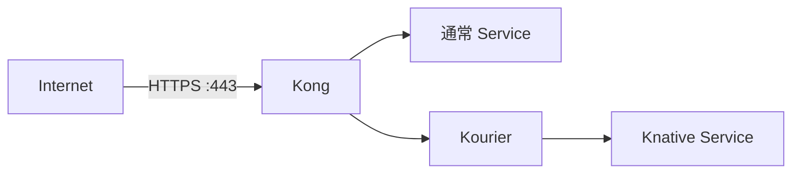

# Caddy と同じ DNS-01 自動証明書発行

cert-manager が Cloudflare DNS API を使って Let's Encrypt の証明書を発行・更新し、
KIC が Secret の変更を Kong に反映する。Caddy と Cloudflare Tunnel は使わない。
公開側の TLS は Kong で終端し、Kourier へは Host を保持して HTTP で転送する。



## 1. DNS と EC2 の準備

Cloudflare の DNS で次の A レコードを **DNS only** として登録し、
いずれも EC2 のパブリック IP（可能なら Elastic IP）を指定する。

| 名前 | 用途 |
| --- | --- |
| `standard.tmp.ys-method-dev.com` | 通常 Service |
| `knative.tmp.ys-method-dev.com` | Knative 用ドメインの証明書対象 |
| `*.knative.tmp.ys-method-dev.com` | 各 Knative Service |

同名の Tunnel 用 CNAME がある場合は、切り替える検証用のレコードだけ整理する。
SSO や Caddy の本番レコードは変更しない。
AAAA レコードを残すなら、その IPv6 接続先も Kong に到達できる必要がある。
DNS only のため、Cloudflare のエッジ証明書・Universal SSL の制約は関係しない。

EC2 セキュリティグループで443/TCPを検証元から許可する。
証明書発行のための80番受信許可は不要。
DNS-01 の通信のため、VM と cert-manager の Pod から Cloudflare API・Let's Encrypt への
HTTPS と、DNS の53番 TCP/UDPでの問い合わせが必要。

## 2. Cloudflare API トークンを配置

Cloudflare の API Tokens で、対象ゾーン `ys-method-dev.com` に限定した次の権限を設定する。

- Zone → DNS → Edit
- Zone → Zone → Read

VM 上のリポジトリのルートで、非表示入力からトークンファイルを作る。
値をコマンド引数・チャット・Git に貼らない。

```bash
mkdir -p .local/secrets
chmod 700 .local/secrets
(
  umask 077
  read -r -s -p 'Cloudflare API token: ' cf_api_token
  printf '\n'
  printf '%s' "$cf_api_token" > .local/secrets/cloudflare-api-token
  unset cf_api_token
)
chmod 600 .local/secrets/cloudflare-api-token
```

`.local/` は Git 管理外。スクリプトはこのファイルから
`sas47-apps/sas47-cloudflare-api-token` Secret を作成する。
Secret 値はログや生成マニフェストへ出力せず、API エラーに値が含まれる場合も表示しない。
再実行時はファイルがあれば更新し、なければ所有ラベル付きの登録済み Secret を使用する。
更新を継続できるようトークンを有効に保つ。失効・ローテーション時はファイルを置き換えて `up` を実行する。

## 3. 設定

`configs/environment/local.json` に次を設定する。`email` は自分の連絡先に変更する。

```json
{
  "mode": "new-host",
  "base_domain": "tmp.ys-method-dev.com",
  "knative_domain": "knative.tmp.ys-method-dev.com",
  "standard_domain": "standard.tmp.ys-method-dev.com",
  "kourier_service": "kourier.kourier-system.svc.cluster.local",
  "node_port": null,
  "tls": {
    "enabled": true,
    "email": "you@example.com",
    "cloudflare_zone": "ys-method-dev.com",
    "cloudflare_token_file": ".local/secrets/cloudflare-api-token",
    "acme_server": "https://acme-v02.api.letsencrypt.org/directory",
    "host_https_port": 443
  }
}
```

`cloudflare_zone` は Cloudflare が管理する DNS ゾーンであり、`base_domain` や
`knative_domain` と同じでなくてよい。
`tls` の省略時は無効で、従来の HTTP 検証設定はそのまま使える。

## 4. 構築・更新

```bash
git pull origin main
sudo ./bin/infra up
```

新規 VM でも既存の専用 VM でも同じコマンド。
TLS 有効時は cert-manager v1.19.1 を公式配布マニフェストから SHA-256 を確認して導入する。
既に所有ラベルのない cert-manager Namespace が存在すれば本体を更新せず、
標準名の3 Deployment と必要 CRD の準備を確認して使用する。
対応しない構成なら停止するため、共有環境の cert-manager を勝手に更新しない。

専用 Namespace に名前付き Issuer と2つの Certificate を作成する。

| Certificate / Secret | 対象 |
| --- | --- |
| `sas47-apps/standard-tls` | `standard_domain` |
| `sas47-apps/knative-wildcard-tls` | `knative_domain` と `*.knative_domain` |

証明書の Ready を各最大600秒待ち、その後に TLS Secret を参照する Ingress と Kong を配備する。
追加の Knative Service も同じ1階層の命名ならワイルドカード証明書を共用できる。
ただしルートとなる Ingress は追加が必要で、任意のホストへの初回アクセス時に
自動で証明書やルートを作る On-Demand TLS ではない。

Kong の8443番を CNI の hostPort でホストの443番へ公開する。
`node_port: null` でも HTTPS にはアクセスできる。
hostPort 使用時は Kong を Recreate で更新するため、更新中に一時的な通信断がある。
既存 Caddy の停止や設定変更はしない。443番を既存プロセスが使用中なら中断する。
別ポートで試す場合は `host_https_port: 8443` とし、URL に `:8443` を付ける。
公開ポートを構築側で設定しない場合は `null` にして、別途 LoadBalancer 等で接続する。
共有ノードでは既存 hostPort の競合にも注意する。

## 5. 確認

外部端末から、証明書を検証したままアクセスする。`-k` は使用しない。

```bash
curl --fail-with-body --max-time 180 https://standard.tmp.ys-method-dev.com/
curl --fail-with-body --max-time 180 https://sas47-apps-serverless.knative.tmp.ys-method-dev.com/
```

期待する本文は `standard-service` / `knative-service`。
ローカルの HTTP とスケールゼロ復帰は従来どおり確認できる。

```bash
sudo python3 scripts/check-routes.py
```

証明書発行状況:

```bash
sudo k0s kubectl -n sas47-apps get issuer,certificate,certificaterequest,orders,challenges
sudo k0s kubectl -n sas47-apps describe certificate knative-wildcard-tls
sudo k0s kubectl -n cert-manager logs deployment/cert-manager --tail=100
sudo k0s kubectl -n sas47-kong logs deployment/kong -c ingress-controller --tail=100
```

Secret 本文は表示しない。DNS API の権限不足、ゾーン名の相違、TXT レコードの伝播、
DNS 問い合わせ経路、ACME の発行制限を診断する。証明書取得に失敗しても再発行のために
クラスタや ACME アカウント Secret を削除せず、原因解消後に `up` を再実行する。

発行制限を避けて事前検証する場合、`acme_server` を
`https://acme-staging-v02.api.letsencrypt.org/directory` に変更する。
staging 証明書はブラウザに信頼されない。公開時は production に戻して再発行を待つ。

## 更新と撤去

cert-manager は期限前に自動更新し、KIC は更新された証明書を反映する。
DNS API トークン、ACME アカウント Secret、DNS・HTTPS の送信通信を維持する。
TLS を無効化しただけでは証明書・トークンを削除しない。
検証環境の `remove` は `sas47-apps` の Issuer・Certificate・Secret も削除する。
TXT レコードの後片付けが終わるまで cert-manager を停止しない。
cert-manager 本体と CRD は他用途に利用され得るため自動削除しない。

証明書発行・更新・外部 HTTPS の実環境での動作は未確認。
設定生成の確認は実際の ACME 発行の検証とは区別する。
