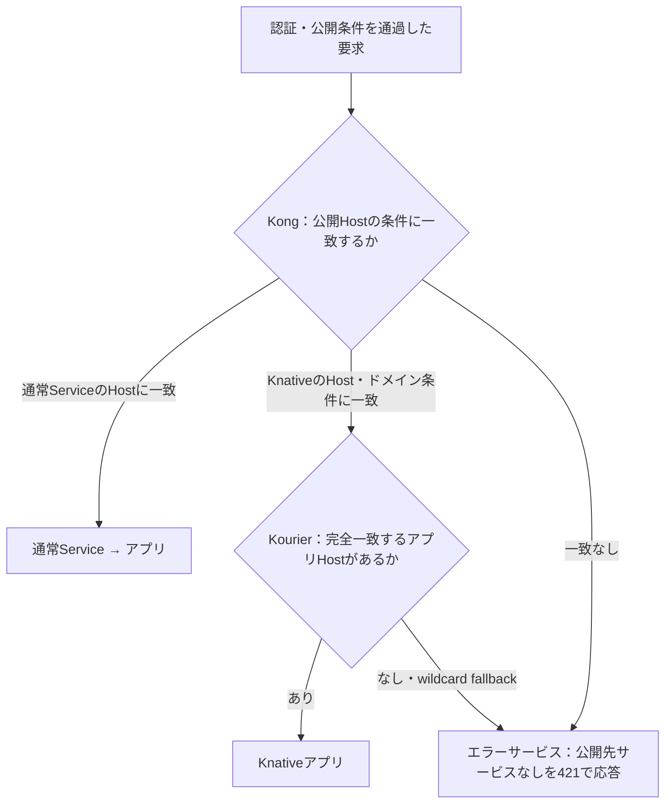

# アプリ公開とルーティング

Kong が HTTPS の入口になり、KIC が Ingress を Kong に反映する。通常 Service へは Kong から直接、
Knative Service へは Kourier を経由して、元の Host を保持したまま転送する。

## 公開経路

環境設定の `routes` に5経路を定義する。[example.json](https://github.com/sasano8/infra-kubernetes/blob/main/configs/environment/example.json) に全体例がある。
`base_domain` は省略可能な参照値で、公開ドメインは各経路の `domain` で指定する。

| ルートID | 種別 | サンプルの認証 | サンプルの公開ホスト |
| --- | --- | --- | --- |
| `standard_domain` | 通常 | SSO | `hello-test-ssvc.<standard_domain>` |
| `standard_nobuffer_domain` | 通常 | SSO | `hello-test-ssvc.<standard_nobuffer_domain>` |
| `knative_domain` | Knative | SSO | `hello-test-ksvc.<knative_domain>` |
| `knative_nobuffer_domain` | Knative | SSO | `hello-nobuffer-test-ksvc.<knative_nobuffer_domain>` |
| `knative_public` | Knative | 公開 | `sso-test-ksvc.<knative_public>` |

## 項目

| 項目 | 意味 |
| --- | --- |
| `kind` | `standard`／`knative`。現在サポートする5経路の種別は固定 |
| `domain` | その経路の公開ベースドメイン。全5経路で重複不可 |
| `auth` | `sso`／`api`／`public`。`knative_public`は`public`専用 |
| `buffering` | レスポンスバッファリングの既定値。JSONの `true`／`false` |
| `request_buffering` | リクエスト本文のバッファリング。省略時は通常経路で `false`、`knative_public` で `buffering` の値 |

5経路の `kind`・`domain`・`auth`・`buffering` は必須。追加の経路IDや未定義の項目は受け付けない。
`auth=sso` は未認証の画面アクセスをGoogle認証へ誘導し、APIパス・GET／HEAD以外などは401を返す。
`auth=api` は未認証時に常に401。`auth=public` は認証せず転送する。
SSOの共通スイッチ `sso.enabled=false` のときは、経路のauth設定にかかわらず認証を適用しない。

認証基盤のGoogle接続・Cookie・Secretなどは `sso` に残す。`sso.routes` は使わない。
レスポンス側の既定値は `buffering` から生成する。既存設定で通常経路のリクエストバッファリングも有効にする場合は、`request_buffering: true` を明示する。
サイズ・タイムアウト・同時数の既定値は [アップロード制限](streaming.md#アップロード制限) を参照。
TLS Secret名は従来どおり維持する。

## アプリの公開先を選ぶ

Knative Service 本体の `metadata.labels` にルートIDを指定する。

```yaml
apiVersion: serving.knative.dev/v1
kind: Service
metadata:
  name: example
  namespace: test
  labels:
    infra.sasano8.dev/route: knative_public
spec:
  template:
    spec:
      containers:
        - image: ghcr.io/mccutchen/go-httpbin:2.21.0
          ports:
            - containerPort: 8080
```

公開ルートを選んだ例。公開URLは `https://example-test-ksvc.knative-public.backoffice.ys-method-dev.com/`。
アプリごとのKong設定は不要。`routes.knative_public.auth`をsso／apiへ変更したり、IDトークン転送を有効にしたりはできない。
SSO有効時も未認証でアプリへ到達する。Kongは共有SSO Cookieと外部からのidentityヘッダーをアプリへ渡さない。

保護経路ではアプリの公開 Host を指定した Kong Ingress を用意する。通常 Service を追加公開する場合も
`ingressClassName: kong-ingress` の Ingress で転送先を定義し、SSO を使う場合は [SSO の公開先設定](sso.md) も確認する。
KIC は `test`／`kong-system` を監視する。`knative_public` はワイルドカードで Kourier に転送するため、アプリごとの Kong Ingress を必要としない。

Knative のルート選択ラベルは Service 本体に置く。`spec.template.metadata.labels` だけでは選択されない。
`mode=new-host` ではインストーラーが `config-domain` を反映する。`mode=existing` では、管理者が
`.local/rendered/knative-config/domain.yaml` と共有クラスタの設定を照合し、必要なエントリーを追加する。

## 種別ごとの既定公開ルート

インストール時のconfigureで通常Service用・Knative用をそれぞれ選択し、JSONへ保存する。

```json
"default_routes": {
  "standard": "standard_domain",
  "knative": "knative_nobuffer_domain"
}
```

明示ルート指定を優先し、省略時は種別の既定を解決する。両方の既定は有効な同種別の
ルートIDが必須。`null`・空文字・未知値・種別不適合は拒否する。
旧設定で `default_routes` や片方のキーが省略されていれば、通常は `standard_domain`、
Knativeは `knative_domain` へ補完する。configure後の再実行で選択を変更しない。
既定の変更は未指定アプリのURL・buffering等を変更するため、影響を確認して再配備する。

4つの明示ルートサンプルに加えて、既定を利用する公開ホストを生成する。

| 検証対象 | 公開ホスト | バックエンド |
| --- | --- | --- |
| 通常の既定 | `hello-default-test-ssvc.<選んだ通常ドメイン>` | 同じ `hello-ssvc` Service |
| Knativeの既定 | `hello-default-test-ksvc.<選んだKnativeドメイン>` | ラベルなしの `hello-default` Knative Service |

既定ホストのbuffering・TLS Secretも選択したルート定義から生成する。これらは生成時の
既定解決を検証するサンプルであり、任意Serviceの継続監視・自動公開はSAS-68の対象。
旧既定ドメインのIngress設定は同名リソースの更新で切り替える。

## Host による転送と未公開ホスト

Kong は保護経路の認証を先に処理し、許可された要求を Host で振り分ける。



ワイルドカードDNSは、アプリが存在しない名前もKongへ到達させる。
DNSのNXDOMAINをHTTPで返すことはできないため、HTTPまで到達した未公開ホストには
`421 Misdirected Request` と `application/problem+json` の `code: unknown_host` を返す。
ただし保護ドメイン内では先に認証を行う。SSO経路の未認証GET/HEADはGoogleログインへの302、
API経路・APIパス・非GET/HEADは401。認証済みなら421となる。
public経路・SSO無効時・設定外の未知Hostは認証前でも421を返す。
保護経路のベースドメインと1階層のサブドメインは設定から生成した専用のエラーIngressで扱い、
完全一致の既存アプリ・認証ホストは個別Ingressを優先する。callbackは引き続き公開する。

| 要求 | 期待する動作 |
| --- | --- |
| 正しいpublicアプリのURL | 200 |
| 正しいアプリ内の存在しないAPI・パス | アプリ自身の404をそのまま返す |
| `knative_public`配下の存在しないアプリ名 | ワイルドカード証明書でTLS検証が成功した後、421 |
| 保護ドメイン配下の未公開Host | 未認証は302（APIは401）、認証後421 |
| 設定外の未知のHost | HTTPまで到達すれば421 |
| 認証ホストの未公開パス（`/`、`/oauth2/auth` など） | 認証用処理が404、`{"error":"path_not_found"}`。Host不一致にはしない |
| DNSに存在しない名前 | 名前解決に失敗。HTTP応答なし |
| DNSが解決しても公開ドメインの範囲外の名前をSNIに指定 | Kongが証明書を返す前にTLSハンドシェイクを終了。HTTP応答なし |
| 有効なTLS接続に設定外の未知のHostを指定 | 421 |
| 存在するサービスの障害・起動待ち | 従来の503などを維持。404・5xxの一律変換はしない |

### エラー経路の実装

- KongにHost条件なしの最後のIngressを置く。既存のHost付きIngressを優先し、未一致要求だけをエラー用Serviceへ送る。
- 公開Hostの入口は認証ホストも含め `/` Prefixとする。パスの扱いは転送先のアプリ・認証用処理が決める。
- Kongのfallbackはbuilt-in request-transformerで `X-Infra-Error: unknown_host` を固定設定し、クライアントのエラー理由・probeヘッダーを除去する。既知Host一覧や404分類は持たない。
- Kourierには、管理対象の各Knative経路ドメインのワイルドカードを受ける内部Ingressを置く。
  実在するKnativeアプリの完全一致Hostを優先し、未一致時だけ `X-Infra-Error: unknown_host` を上書きして転送する。
- 転送先は `error_service` の通常のKubernetes Service・単一ポート。呼び出し元ごとのポートは使わない。
- 既定はログイン画面 `test/sso` と同居するアプリ。`min-scale: 1` で常駐し、
  `test/platform-portal` Serviceからユーザーコンテナ8080番へ直接接続する。Kourier／queue-proxyへ戻さない。
- 通常のアプリ経路・認証ホストでもrequest-transformerでクライアントの `X-Infra-Error` とKnative内部専用ヘッダーを除去する。
  `K-Original-Host` によるHost認識の変更や外部probeの偽装を防ぎ、内部コントローラーの通信は維持する。
  本文の変換を設定しないため、このヘッダー処理で本文を読み込まない。
- 以前の独立した `route-errors` Deployment・Service・ConfigMapは、所有ラベルを確認して`up`で撤去する。
- アプリが返した404・500などは変更しない。エラー生成サービスの形式・設定・probe仕様は
  [エラーサービスの接続プロトコル](error-service.md)を参照。

Knative内部Ingressとprobeの形式は、導入版 `knative-v1.20.0` に合わせている。
upstreamの [KourierのHost生成](https://github.com/knative-extensions/net-kourier/blob/knative-v1.20.0/pkg/generator/ingress_translator.go) と
[probeの挿入](https://github.com/knative/networking/blob/release-1.20/pkg/ingress/ingress.go) を前提とする。

[動作確認](verification.md) で DNS と loopback の両方から、認証前後のステータスを検証できる。
証明書の設定は [HTTPS](https.md)、転送時のバッファリングは [ストリーミング](streaming.md) を参照。

## 旧設定からの移動

| 旧設定 | 新設定 |
| --- | --- |
| トップレベルの `knative_domain` などの文字列 | `routes.<経路ID>.domain` |
| `sso.routes.<経路ID>` | `routes.<経路ID>.auth` |
| コード内のbuffering定義 | `routes.<経路ID>.buffering` |
| 通常／Knativeの種別 | `routes.<経路ID>.kind` |

旧ラベル `infra.sasano8.dev/buffering: disabled` は `infra.sasano8.dev/route` に移す。
旧トップレベルのドメイン項目、`domain`・`standard_host`別名、`sso.routes`は削除する。
旧形式の互換読み込み・自動変換は行わず、検証エラーにする。
ドメイン・auth・bufferingの値を維持して移し替えれば、公開URLと認証動作は変わらない。
Google callback、共有Cookie範囲、アプリのラベルを変える必要もない。

```bash
git pull --ff-only origin main
make edit-config
./bin/infra validate --require-https
make up
```
