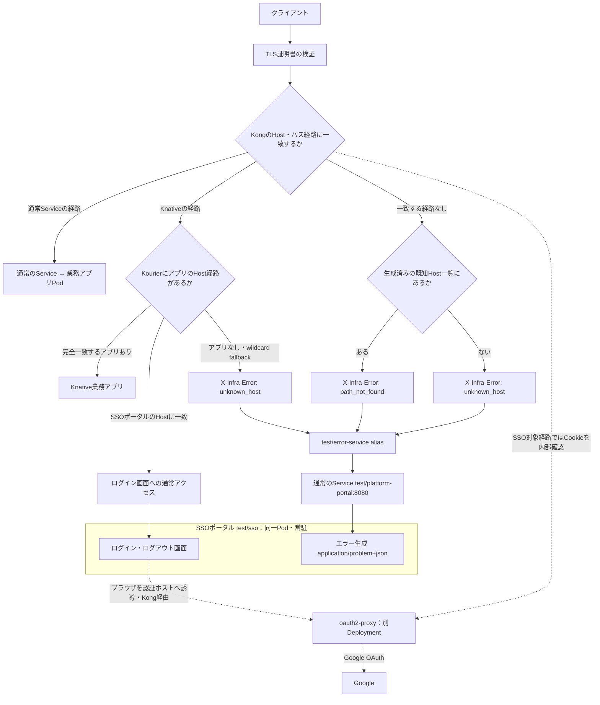
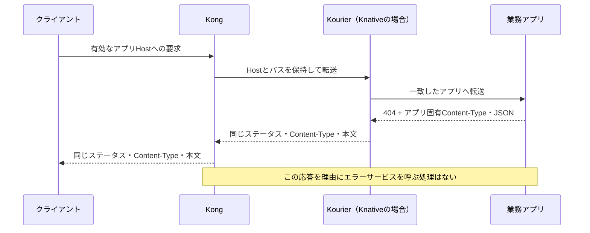
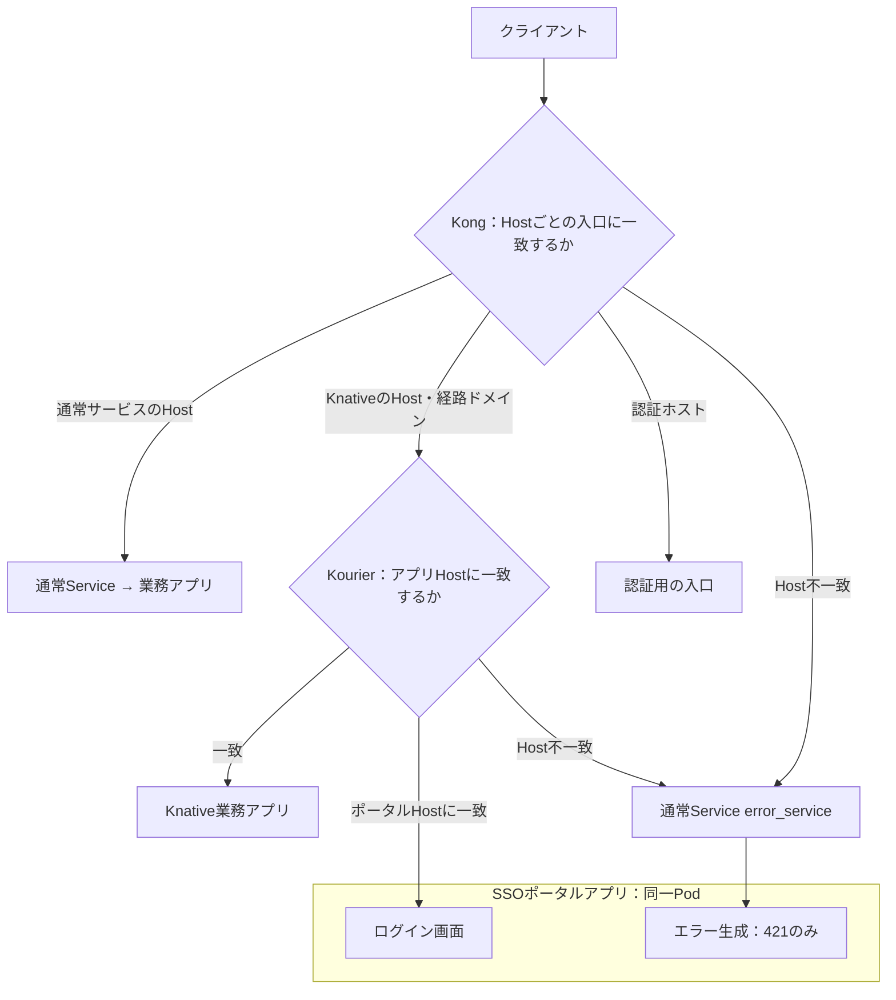

# Host判定、アプリ転送、SSOポータルとエラー生成

現在の実装を示す。簡素化後の構成は後半に分けて記載する。

## 現在の転送経路

通常の業務リクエストの本文は、KongからServiceまたはKourierへ進む。
oauth2-proxyにはCookieによる認証確認を送り、業務リクエストの本文は送らない。
SSO認証不要のpublic経路ではその確認を行わない。

エラー生成とログイン画面は **SSOポータルの同じアプリ・同じPod** に入っている。
Google OAuth・セッション確認を行う **oauth2-proxy本体は別のDeployment**。
「認証サービスに同梱」は、ログイン画面を提供するポータルに同梱する意味であり、
oauth2-proxyのプロセスやコンテナを改変してエラー処理を追加したわけではない。

エラー経路は通常のServiceからユーザーコンテナ8080番へ直結し、Kourier・Activator・queue-proxyへ戻さない。
別の `error_service` を指定した場合も、通常のServiceへ直接接続する。

## アプリ自身の404は上書きしない

通常ServiceではKourierを挟まず、Kongからアプリへ転送する。同じくアプリの応答を維持する。
エラーサービスを使うかどうかは、転送前に経路が見つからなかったかで決まる。
アプリのレスポンスコード・JSONを読んでエラーサービスへ振り直すことはしない。
SSOの認証確認とCookie更新などの処理は別であり、業務アプリのJSONを書き換えるものではない。

現在の結合テストは、アプリの404本文がそのまま返ることを確認している。
アプリ固有JSONのContent-Typeを含めた検証拡充は、下記の簡素化計画に含める。

## 現在の余分な処理

Kongの最後のfallbackには、既知Host一覧から404か421かを決めるpre-functionがある。
これは「認証ホストは存在するが `/` を公開していない」といった場合を、
未知Hostと区別しようとして追加したもの。アプリから返ってきた404の処理ではない。

Host不一致だけをエラーサービスへ送る目的なら、この一覧と404分類は不要。
また、新しいHostの入口を別管理で追加した場合に一覧と実際の経路がずれる問題もある。
この処理は [簡素化計画](plans/simplify-host-errors.md) で撤去する対象。

## 簡素化後の目標（未実装）

認証ホストもHost単位の入口へ振り分け、未定義パスはその入口で404にする。
外部公開しない認証用パスの制限は、Host不一致とは別の既存処理として扱う。
業務アプリへ接続した後の404・421・500などは、アプリ自身の応答を返す。
エラーサービス自身に存在しないパスへの404も、そのアプリ自身の通常の404である。

## 実装と検証の参照先

- [Kongの経路とfallback](../plugins/kong/manifests/routes.yaml.tmpl)
- [Kourierのfallback](../apps/route-errors/manifests/apps.yaml.tmpl)
- [ポータルと通常Serviceの生成](../scripts/sso.py)
- [エラー生成とログイン画面のHTTPサーバー](../apps/platform-portal/server.py)
- [接続プロトコル](error-service.md)
- [現行動作・実機確認](routing-errors.md)
- [実プロキシの結合テスト](../tests/check_route_errors.py)
