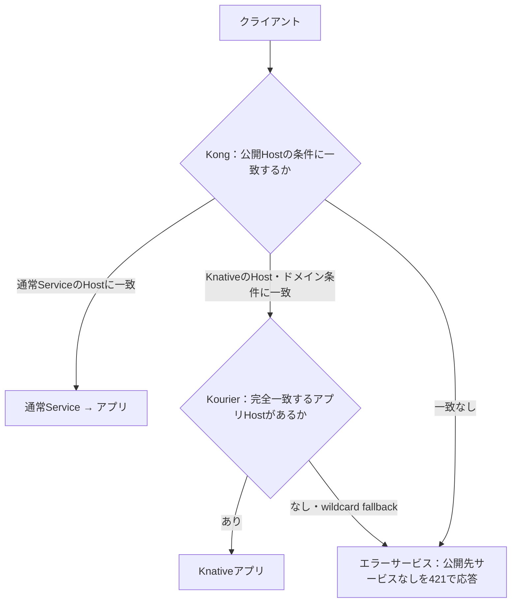

# Hostによる転送とエラー生成の配置

入口の判定はHostに絞る。公開されたHostなら転送先へ渡し、未公開のHostなら421を返す。
パスが存在するかは転送先が判断する。SSOポータルも、この点では他のアプリと同じである。

以下は現在の実装。

## Hostによる転送

要求されたHostに対応する公開先サービスへ転送し、公開先が定義されていなければエラーサービスが421（対応する公開先サービスなし）を返す。

Kongでは公開するHostの入口を `/` Prefixに揃え、すべてのパスを転送先へ渡す。
Kongの経路設定にはパス条件が残るが、`/` が全パスを受けるため、入口の振り分けはHostで決まる。
既存のbuffering／no-buffering設定は各経路で維持する。

Knativeのワイルドカード経路はKourierへ転送するための入口であり、アプリの存在を保証するものではない。
Kourierが完全一致するアプリHostへ転送し、アプリがなければwildcard fallbackからエラーサービスへ渡す。
Kong側で個別Hostだけを公開する経路では、その公開設定への一致も必要になる。

ログイン画面を提供するポータルも、通常のKnativeアプリとして「あり」の経路を通る。
ポータル専用のHost判定や分岐は設けない。
認証の要否は各経路の設定に従うが、この図はHostによる転送だけを示している。
SSOの処理は [SSOの構成とリダイレクト](sso-flow.md) を参照。

## パスとアプリの応答

Hostが一致すれば、パスは転送先の責任とする。
転送先が404を返しても、Kong・Kourierはその応答をエラーサービスへ振り直さない。

| 状況 | 応答する主体・結果 |
| --- | --- |
| 公開Hostに一致しない | エラーサービスから421、`unknown_host` |
| Knativeドメインには一致するが、アプリHostが存在しない | 同上 |
| アプリHostが存在し、パスが存在しない | アプリ自身の404 |
| アプリが独自JSONで404・421・500などを返す | アプリのステータス・Content-Type・本文を維持 |

**プロキシのfallbackで `path_not_found` と `unknown_host` を区別する必要はない。**
アプリ自身が404の本文として `path_not_found` を使うことは、この入口判定とは別である。
認証ホストもHost全体の入口を用意し、未公開の認証用パスはその転送先の処理で拒否する。
`/oauth2/auth` などの外部公開制限を解除するという意味ではない。

TLS証明書の検証はHTTPより前に行われる。証明書対象外のHostでは、421を見る前にTLS検証で失敗し得る。

## エラー生成サービスの配置

エラー生成は、ログイン画面を提供するポータルアプリに同梱している。
Google認証を処理するoauth2-proxy本体とは別である。
接続先などの詳細は [エラーサービスの接続プロトコル](error-service.md) を参照。

## 404分類の撤去

Kongの生成済み既知Host一覧と、fallbackで404／421を分類するLua処理は撤去済み。
認証ホストも `/` Prefixで受け、未公開パスは既存の認証用処理が404で拒否する。
Kong・Kourierのfallbackは、どちらも `unknown_host` の421だけをエラーサービスへ要求する。

変更内容と受け入れ条件は [簡素化の実施記録](plans/simplify-host-errors.md) を参照。

## 実装と検証の参照先

- [Kongの経路とfallback](../plugins/kong/manifests/routes.yaml.tmpl)
- [Kourierのfallback](../apps/route-errors/manifests/apps.yaml.tmpl)
- [ポータルと通常Serviceの生成](../scripts/sso.py)
- [エラー生成とログイン画面のHTTPサーバー](../apps/platform-portal/server.py)
- [接続プロトコル](error-service.md)
- [現行動作・実機確認](routing-errors.md)
- [実プロキシの結合テスト](../tests/check_route_errors.py)
