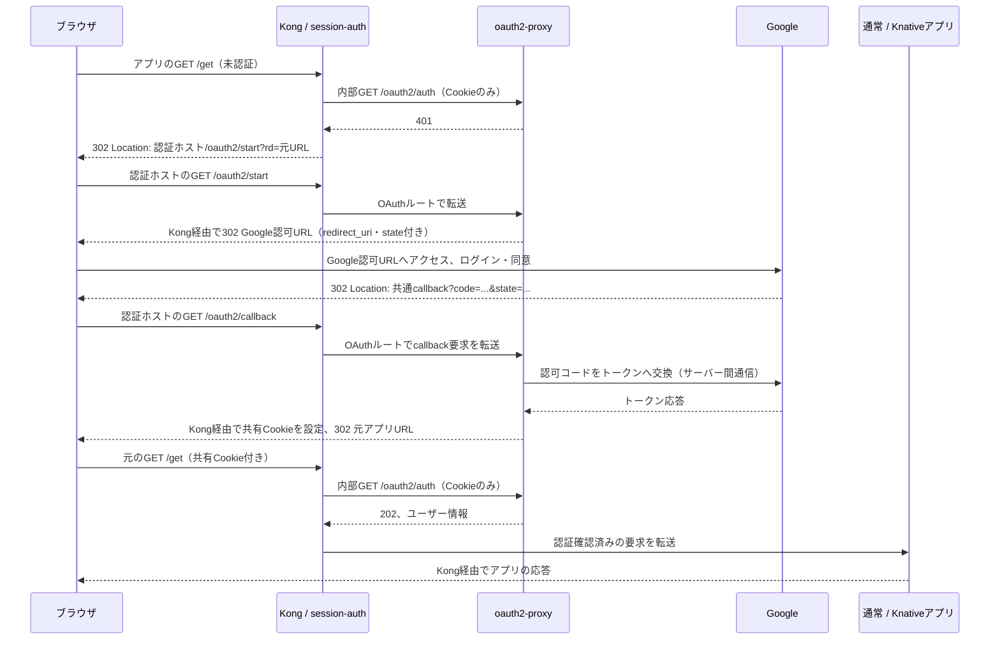

# Google SSOのリダイレクトとKongのcallback転送

Googleはログイン後、ブラウザを認証専用ホストのcallback URLへ戻す。
Kongはその要求をoauth2-proxyへ転送し、oauth2-proxyが認証を完了して元のアプリへ戻す。
callbackを処理するのはoauth2-proxyで、通常アプリやKnativeアプリには実装しない。

## それぞれの役割

| 担当 | 処理 |
| --- | --- |
| ブラウザ | HTTPリダイレクトに従ってアプリ・認証ホスト・Googleへアクセスし、Cookieを保持する |
| Kong | 公開Hostとパスから転送先を選ぶ。アプリ要求の認証確認と、認証ホストのOAuth要求の転送を行う |
| session-authプラグイン | アプリへの要求でCookieを検証するためoauth2-proxyへ問い合わせ、未認証のブラウザをログインへ誘導する |
| oauth2-proxy | Googleへの認可要求、callbackの検証、認可コードとトークンの交換、SSOセッションの発行を担当する |
| Google | ユーザーのログイン・同意を処理し、登録済みのcallbackへ認可コードを返す |
| 通常／Knativeアプリ | Kongで認証を確認した後の要求を受ける。Google callbackの処理は不要 |

## callbackと元アプリへの戻り先は別のURL

通常アプリの `/get` を開く場合の例：

| URL・パラメーター | 例 | 用途 |
| --- | --- | --- |
| 元アプリのURL | `https://hello-test-ssvc.standard.tmp.ys-method-dev.com/get` | ログイン後に利用したい画面・API |
| ログイン開始URL | `https://auth.knative.tmp.ys-method-dev.com/oauth2/start?rd=<URLエンコードした元アプリURL>` | Kongが未認証ブラウザを誘導する先 |
| Googleへの `redirect_uri` | `https://auth.knative.tmp.ys-method-dev.com/oauth2/callback` | Googleから認可コードを受け取る固定URL |
| oauth2-proxyへの `rd` | 元アプリのURL | 認証完了後の戻り先。Googleのcallback登録には追加しない |

Googleへ登録するのは認証専用ホストのcallbackだけ。
どのアプリを開いたかはoauth2-proxyが認証フローのstateと関連付けて扱い、callbackで認証を完了した後に戻す。
Googleが各アプリへ直接リダイレクトする構成ではない。

## 初回ログインの流れ



Googleの「転送」はブラウザへのHTTPリダイレクト。
GoogleがKongへ直接callbackを送るわけではなく、Googleの応答を受けたブラウザがKongへアクセスする。
一方、認可コードとトークンの交換はoauth2-proxyとGoogleのサーバー間通信で行う。
Kongはその交換を実装せず、callbackのクエリをoauth2-proxyへ引き渡す。
callbackのクエリには認可コードが含まれるため、調査時もURL全体を共有ログへ貼らない。

## Kongが `/oauth2/callback` を処理する条件

SSO有効時に生成する `test/oauth2-proxy` Ingressが、次の組み合わせを受け持つ。

| 項目 | 設定 |
| --- | --- |
| Host | `sso.auth_host`：この例では `auth.knative.tmp.ys-method-dev.com` |
| パス | `/oauth2` のPrefixルート |
| 転送先 | `test/oauth2-proxy` Service、ポート4180 |
| TLS証明書 | この例では既存の `knative-wildcard-tls` Secret |
| Kongプラグイン | `sso-oauth-endpoints`：OAuth用の公開パスと認証ホストを検証 |

このOAuthルートでは通常のアプリ用セッション認証を要求せず、ログイン開始とcallbackを受け付ける。
認証ホストで公開するパスは `/oauth2/start`、`/oauth2/callback`、`/oauth2/sign_in`、`/oauth2/sign_out`。
ログイン画面は通常のKnativeアプリ `test/sso` として `knative_public` 経路に公開する。
URLは `https://sso-test-ksvc.<knative_public>/`。KongがHTMLを返す特別処理はない。
ボタンは認証ホストの `/oauth2/start` または `/oauth2/sign_out` を呼び、
`rd` にログイン画面の絶対URLを指定して完了後に戻る。戻り先はoauth2-proxyのallowlistへ登録する。
ページ表示だけでは認証を開始せず、セッション状態も表示しない。
認証ホストの `/` はルートを定義しない。
アプリから通常の認証を開始した場合は、従来どおり元アプリへ戻る。
セッション確認用の `/oauth2/auth` はKongからクラスタ内部で呼び、外部OAuthルートでは拒否する。
認証専用ホストにはKnative Serviceを作らず、Kourierも経由しない。

Hostもルート選択の条件になるため、任意のアプリホストの `/oauth2/callback` を
一律にoauth2-proxyへ転送するわけではない。旧構成のアプリ別callback登録は移行確認後に削除できる。

## Google側へのリダイレクトURIの追加

1. Google Cloud Consoleの「Google Auth Platform → クライアント」、または
   「APIとサービス → 認証情報」から、使用するOAuth 2.0クライアントを開く。
   種類は「ウェブアプリケーション」を使用する。
2. `.local/secrets/google-sso.json` の `GOOGLE_CLIENT_ID` と同じクライアントを選ぶ。
3. 「承認済みのリダイレクトURI」に次を追加して保存する。

   ```text
   https://auth.knative.tmp.ys-method-dev.com/oauth2/callback
   ```

4. environment JSONの既存 `sso` オブジェクトに次を設定し、一括反映する。

   ```json
   "auth_host": "auth.knative.tmp.ys-method-dev.com",
   "cookie_domain": "tmp.ys-method-dev.com"
   ```

   ```bash
   ./bin/infra up --require-https
   ```

oauth2-proxy側には `--redirect-url=https://<auth_host>/oauth2/callback` が生成される。
この値とGoogle側の登録値を、スキーム・ホスト・ポート・パス・末尾スラッシュまで一致させる。
公開HTTPSポートが9443なら、両方を `https://<auth_host>:9443/oauth2/callback` にする。
ワイルドカードや `?code=...&state=...` は登録しない。
「承認済みのJavaScript生成元」への追加は、このサーバー側OAuthフローのcallback登録の代わりにはならない。

`redirect_uri_mismatch` が出た場合は、Googleのエラー詳細の `redirect_uri` と
**使用しているクライアント**の登録値を照合する。各アプリのURLを追加して回避する必要はない。

## 別アプリへのアクセスとbuffering

認証後の `__Secure-infra_sso` Cookieは、`tmp.ys-method-dev.com` 配下で共有する。
別の通常／Knativeアプリを開いたときも、Kongが同じセッションを内部確認するため、
有効なセッションがあればGoogleログインを繰り返さずアプリへ到達できる。
KongはSSO Cookieをアプリへの転送から除去し、アプリ独自のCookieを維持する。

認証確認は本文を伴わない内部GETで、buffering／no-bufferingは各アプリルートの設定を維持する。
未認証のPOST等やAPI対象パスは401を返し、ログイン後の本文再送は行わない。
アプリ追加時は現在の公開Host allowlistにも追加が必要だが、Google側のcallback追加は不要。
Cookie共有範囲、信頼境界、移行手順と実機確認の項目は [SSO設定手順](sso.md)を参照。

## 実装箇所

- [scripts/sso.py](../scripts/sso.py)：認証URL・Cookie・戻り先allowlist・OAuth Ingressの生成。
- [session-auth/handler.lua](../plugins/sso/kong/plugins/session-auth/handler.lua)：認証確認、ログイン誘導、OAuth公開パスの制限。
- [SSO設定手順](sso.md)：資格情報、Cookie共有、IDトークン転送、切替・検証手順。
