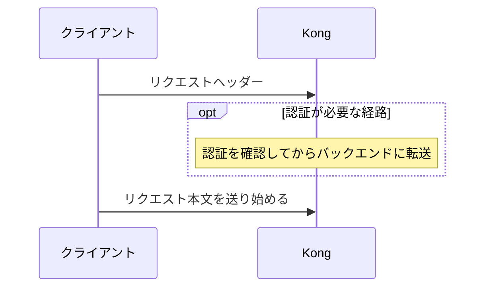
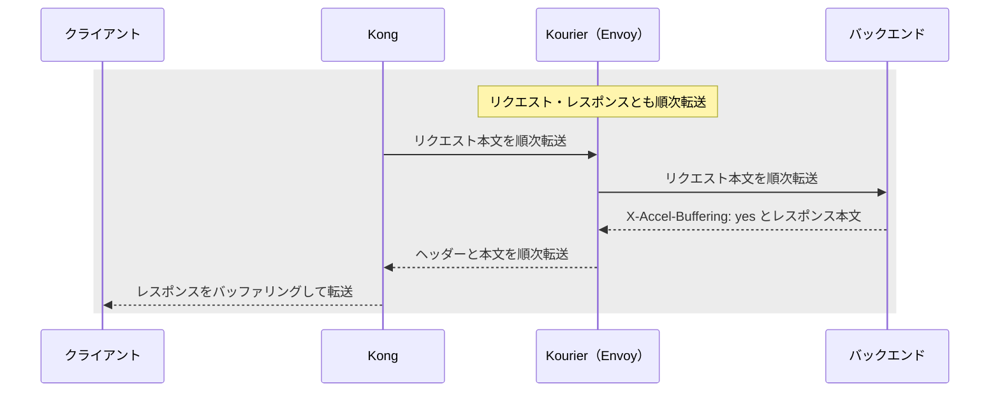
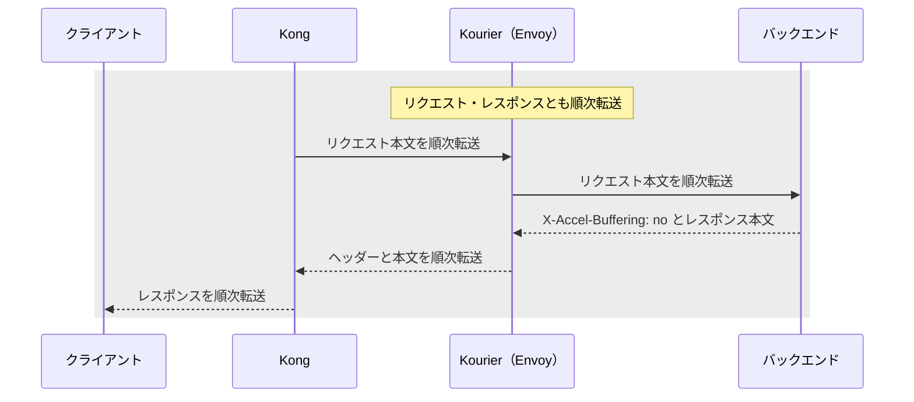
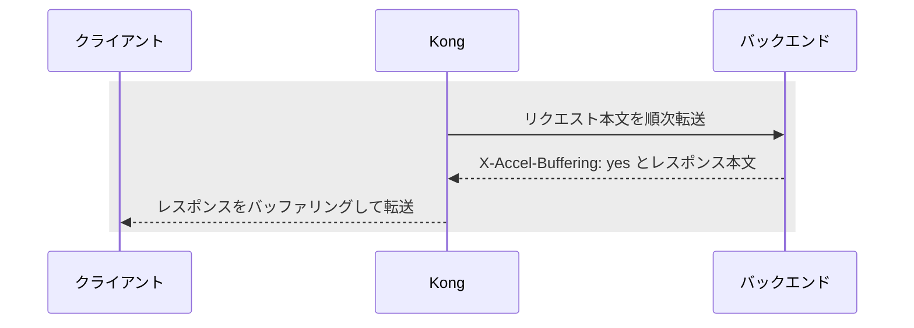
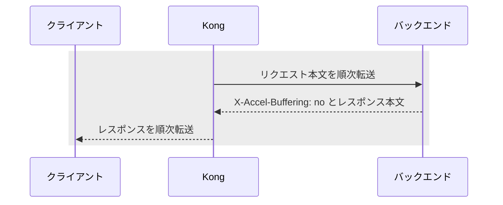

# ストリーミングの設計と検証

Kong と Kourier を経由するリクエスト本文とレスポンスの転送方針を示す。
現行のサンプル構成では、通常 Service と Knative の各経路でデータの到着時刻を比較できる。

## リクエストの逐次転送とレスポンスの制御方針

この節は導入方針を示す。現在のサンプル設定は [現行の検証構成](#現行の検証構成) を参照。

アプリ向け経路では、認証が必要な場合は先に認証を行い、`konghq.com/request-buffering: "false"`
でリクエスト本文を受信しながらバックエンドへ順次転送する方針とする。
認証アプリにもリクエストの逐次転送を適用し、レスポンスはバッファリングを有効にする。
自前の認証アプリは `X-Accel-Buffering: yes` を返す。`oauth2-proxy` は Kong の認証 Ingress で
`konghq.com/response-buffering: "true"` を指定する。
公開ドメイン（`knative_public`）では各ルートの設定を使う。
レスポンスに `X-Accel-Buffering` がある場合は、Kong がその値に従って処理する。
図は逐次転送の対象経路を示す。ヘッダーを省略したレスポンスは Kong のルート設定に従う。

### 共通手順



以下の各ケースは、共通手順のあとに続く別々の経路を示す。
`oauth2-proxy` は Kourier を経由せず、レスポンスのバッファリングを有効にするケースと同じ転送になる。

### Kourier 経由（Knative）・`X-Accel-Buffering: yes`



### Kourier 経由（Knative）・`X-Accel-Buffering: no`



### Kourier なし（通常 Service）・`X-Accel-Buffering: yes`



### Kourier なし（通常 Service）・`X-Accel-Buffering: no`



## Kong と Kourier のバッファリング

### リクエスト本文

`konghq.com/request-buffering: "false"` の経路では、Kong は本文の受信完了前から上流へ転送する。
アプリが受信しながら保存する場合は、本文を順次読み取り、転送完了後に保存を確定する。

### アプリからレスポンス単位でバッファリングを無効にする

SSE など、特定のレスポンスを逐次配信する場合は、アプリのレスポンスに次のヘッダーを付ける。

```http
X-Accel-Buffering: no
```

Kong の既定構成では、buffer 経路でもこのヘッダーを受け取ったレスポンスのバッファリングを無効にできる。
`yes` を返すとそのレスポンスのバッファリングを有効にし、ヘッダーの指定がなければ
ルートの `konghq.com/response-buffering` に従う。
逐次配信は、[少しずつ返るレスポンス](#少しずつ返るレスポンス)の手順でデータの到着時刻を確認する。
詳細は [Kong の SSE 設定ガイド](https://developer.konghq.com/support/how-can-i-use-kong-to-allow-sse-server-sent-events/) を参照。

### Knative 経路での Kourier と Kong の動作

Knative 経路では Kong とアプリの間に Kourier（Envoy）が入る。
この構成の Kourier v1.20 は、Kong のルート設定にかかわらず、リクエストとレスポンスの
どちらも本文全体の受信完了を待たずに順次転送する。
[Kourier v1.20 の Envoy 設定](https://github.com/knative-extensions/net-kourier/blob/knative-v1.20.0/pkg/envoy/api/http_connection_manager.go)

アプリが返した `X-Accel-Buffering` は Kourier を経由して Kong に届く。

## 現行の検証構成

通常 Service（`test/hello-ssvc`）と Knative（`test/hello`・`test/hello-nobuffer`）は、
`ghcr.io/mccutchen/go-httpbin:2.21.0` を使う。疎通確認は `/get`、受信ヘッダーの確認は
`/headers`、エンドポイント一覧は `/` で確認できる。

| サンプルの経路 | リクエストバッファリング | レスポンスバッファリング |
| --- | --- | --- |
| 通常／Knative の buffer | `true` | `true` |
| 通常／Knative の nobuffer | `false` | `false` |

Kong Ingress には `konghq.com/request-buffering` と `konghq.com/response-buffering` を指定する。
Knative への転送では Kourier に Host を保持して渡す。
一般アプリへの公開ルート設定の自動反映は別課題（SAS-68）。
[4経路の構成](four-routes.md)・[Kong の Ingress 設定](https://developer.konghq.com/kubernetes-ingress-controller/reference/annotations/)

| 項目 | サンプルの設定値 |
| --- | --- |
| アプリの本文上限 | 64 MiB |
| 遅延レスポンスの上限 | 60秒 |
| アプリの読み取り期限・Knative のリクエスト期限 | 120秒 |
| Kong の上流への読み書きタイムアウト | 180秒 |

## S3 のマルチパートアップロードとサイズ上限

boto3 の `upload_file()` などの転送 API は、設定したしきい値に達したファイルを分割して送る。
S3 の `UploadPart` はパートごとに独立した HTTP リクエストなので、Kong を経由する場合、
本文上限・タイムアウト・リクエストバッファリングは各パートに適用される。
たとえば 2 GiB のファイルを 64 MiB ずつ送れば、Kong の本文上限が 105 MiB でも、
各パートはサイズ上限内に収まる。完成するオブジェクトの上限はストレージ側の仕様に従う。
署名付き URL でストレージへ直接送る場合、ファイル本体には Kong の制限がかからない。
[boto3 の転送設定](https://boto3.amazonaws.com/v1/documentation/api/latest/guide/s3.html)・[S3 のパートとオブジェクトの上限](https://docs.aws.amazon.com/AmazonS3/latest/userguide/qfacts.html)

アプリ独自の最大サイズはアップロード方式に応じて設ける。Amazon S3 の署名付き POST では
`content-length-range` でサイズの範囲を指定できる。マルチパートでは、アプリがアップロードの完了を管理し、
送信済みパートの合計を確認してから完了させる。Amazon S3 では完了時に `MpuObjectSize` を指定すると、
期待した合計サイズとの一致も検証できる。署名やサイズ検証の互換性は採用する実ストレージで確認する。
[S3 の POST ポリシー](https://docs.aws.amazon.com/AmazonS3/latest/developerguide/sigv4-HTTPPOSTConstructPolicy.html)・[S3 の完了 API](https://docs.aws.amazon.com/AmazonS3/latest/API/API_CompleteMultipartUpload.html)

## 検証手順

通常 Service と Knative の buffer／nobuffer の4経路で、同じ条件の試験を行う。

### 配備と前提

既存環境では設定を確認してから `bin/infra deploy` で再配備する。
[疎通確認](verification.md)の4経路・Host・スケールゼロ復帰を先に実施する。
上限を超えるテストを行う場合は、現行の検証構成に示す値を見直す。

以下はリポジトリルートで Bash、curl、Python 3 を使う。
外部公開の確認は別ネットワークの端末で実行する。TLS検証を無効にしない。
SSO が有効な場合は [SSO 手順](sso.md) に従ってログインし、認証済みのリクエストで
確認する。Cookie・トークンや認証ヘッダーは証跡に含めない。保護経路では未認証の
アップロードは 401、認証サービス障害時は 503 になる。

```bash
set -euo pipefail
mkdir -p .local/results
# 自分の通常 nobuffer 公開URLを指定。4経路それぞれで同じ試験を実施する。
BASE=https://hello-test-ssvc.standard-nobuffer.tmp.ys-method-dev.com
curl --fail-with-body --silent --show-error --max-time 180 "$BASE/get"
curl --fail-with-body --silent --show-error --max-time 180 "$BASE/headers"
```

SSO 無効時に内部経路を HTTP で切り分ける場合は、Kong の port-forward を使用し、
URL を `http://127.0.0.1:8080` に変更して `-H 'Host: 対象の公開ホスト'` を追加する。
Knative は先に `/get` で起動させ、コールドスタート時間と転送遅延を分けて測る。

### 少しずつ返るレスポンス

```bash
curl --fail-with-body --silent --show-error --no-buffer --max-time 30 \
  "$BASE/drip?duration=10&numbytes=20&delay=0" |
  python3 -u -c 'import sys,time
start=time.monotonic()
while True:
    data=sys.stdin.buffer.read1(4096)
    if not data:
        break
    print("%.3fs: %d bytes" % (time.monotonic()-start, len(data)))' |
  tee .local/results/drip-arrivals.log
```

10秒の終了時にまとめて届くのではなく、途中から継続的に到着するかを確認する。
HTTPヘッダーの到着時間だけで判定しない。小さなチャンクがネットワークで合流する
ことはあるため、20回の到着を必須にしない。疑わしければアプリ直結・Kourier経由・
Kong経由を比較し、どの段階で遅延するかを切り分ける。
バッファリング有効でも、レスポンスの一部が完了前に届くことがある。

### 大容量ダウンロード・アップロード

#### ダウンロード

```bash
curl --fail-with-body --silent --show-error --max-time 90 \
  "$BASE/stream-bytes/33554432?chunk_size=16384" \
  -o .local/results/download.bin \
  -w 'status=%{http_code} bytes=%{size_download} first_header=%{time_starttransfer} total=%{time_total}\n'
test "$(wc -c < .local/results/download.bin)" -eq 33554432
```

#### アップロード

本文を受信しながら破棄する `/upload` に、32 MiB を約32秒かけて送る。

```bash
dd if=/dev/zero of=.local/results/upload.bin bs=1048576 count=32
curl --fail-with-body --silent --show-error --max-time 90 \
  --limit-rate 1M -H 'Content-Type: application/octet-stream' \
  --data-binary @.local/results/upload.bin "$BASE/upload" \
  -o .local/results/upload.json
python3 -c 'import json; r=json.load(open(".local/results/upload.json")); assert r["bytes_received"] == 33554432; print("upload: 32 MiB received")'
```

ファイルサイズと受信バイト数で転送結果を確認する。リクエストが逐次転送されたかは、
送信完了前にバックエンドへ本文が届いていることをパケット観測などで確認する。
go-httpbin の完了ログだけを取得した場合は「転送成功／request 非バッファリング未確認」と記録する。
あわせて Kong・Kourier・queue-proxy・アプリのメモリと一時ディスクを観測する。

## 証跡

通常／Knative、buffer／nobuffer、内部／外部を明記し、実行コミット、日時、HTTP バージョン、
Ingress の設定、転送量、データの到着時刻を記録する。転送結果と逐次到着の観測結果は
別々に記録し、未実施の確認にはその旨を記す。経路間で差が出なかった場合も実測値を残す。
比較に使った他のプロキシや、メモリ・一時ディスクの観測値も添える。
現時点で本版の実クラスタ検証は未実施。
[go-httpbin v2.21.0](https://github.com/mccutchen/go-httpbin/tree/v2.21.0)
